# Reference boards: the strategy-game look at 40 m, 300 m and 2 km (T-020, Grok)

Nine boards (buildings, terrain and towns at 40 m, 300 m and 2 km), all in the **Iron age, Valley people**, in
one invented valley: a walled river town with a white temple on its plaza, a timber bridge, gold and green
fields, forest along the river and snow mountains to the north. Plus four extension sheets: `ages-300m.png`,
`cultures-300m.png`, `night-300m.png` and `do-and-dont.png`. All images are original and generated for this task.
The look is described only by its qualities; no existing game, studio, film or artist is named or imitated.

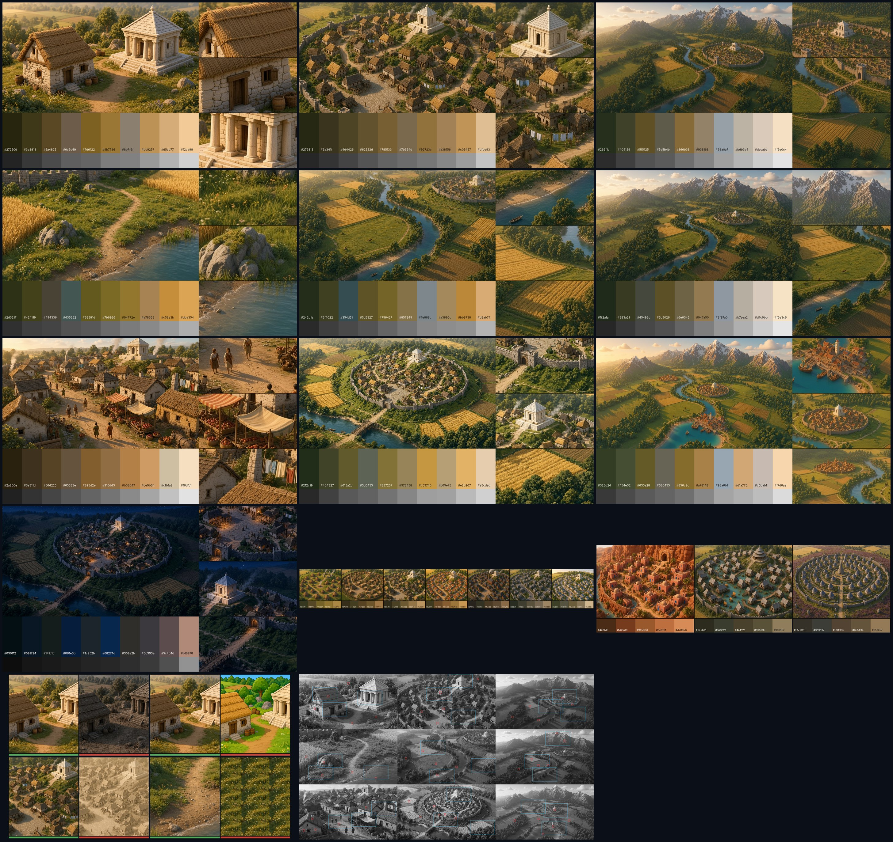

## How these were made

- **Generator:** the bot's built-in image generator, 16:9 (1280 x 720) for heroes and 4:3 (1152 x 864) for
  the age and culture panels. Every prompt below is recorded verbatim, with its reference image.
- **Continuity of scale:** `hero-towns-300m.png` was made first with no reference and is the anchor of the
  valley. The 40 m and 300 m heroes and the night view used it as the reference image. `hero-terrain-2km.png`
  used `hero-terrain-300m.png`, and the two other 2 km heroes used `hero-terrain-2km.png`. The ages and
  cultures used `hero-buildings-300m.png` as "the same street corner".
- **Board layout (1920 x 1080):** hero at full 1280 x 720 in the left two thirds. Three detail crops in the right
  column, each a 320 x 180 px part of the hero enlarged 2x to 640 x 360. A palette strip of 10 swatches with
  sRGB hex codes along the bottom, and under it the same swatches in greyscale (relative luminance), so the
  value structure can be read straight off the board. No text in the heroes.
- **Palette:** k-means (10 clusters, `scipy.cluster.vq.kmeans2`, seed 7) on the hero downsampled to 320 x 180.
  Each swatch is the per-channel median of its cluster. Y is relative luminance (sRGB decoded, Rec. 709 weights).
- **Greyscale check:** 24 x 24 px median samples of roof, wall, ground and vegetation (or the terrain materials)
  at the hero coordinates listed, converted to CIE L*. `greyscale-check.png` shows all nine heroes in greyscale
  with the sample boxes (red) and crop boxes (blue). A pair of materials passes the flat value-band test at
  ΔL* ≥ 10 (about a 20-25 % luminance difference at these levels).
- **Scripts** (in `src/`, run from the repo root):
  - `src/boards.py` (numpy, scipy, Pillow) holds the crop and sample coordinates, measures the palettes and
    samples, and writes `src/boards.js` and `greyscale-check.png`.
  - `src/board.html` lays out one board from `boards.js` (hex codes in Inter from `assets/fonts/`).
  - `src/render.js` renders it with headless Chrome: `node docs/concept/reference-boards/src/render.js <board> <out.png>`
    (run from `docs/concept/reference-boards/`). The puppeteer-core module and the Chrome binary come from the
    environment variables `PUPPETEER_CORE` and `CHROME_PATH`, with fallbacks to `puppeteer-core` /
    `/workspace/proto-tools/node_modules/puppeteer-core` and `/usr/bin/google-chrome`.
  - `src/ext.py` (Pillow, numpy) builds `ages-300m.png`, `cultures-300m.png`, `do-and-dont.png` and
    `contact-sheet.jpg`.
- **Read first, not found:** the style-pilot sheets `shots/style-s300.png`, `shots/style-s80.png`,
  `shots/style-c15.png` and `shots/style-swatches.png` are not in the repository, so the boards follow the
  written brief in `art/style-pilot/README.md` (S2 stylised realism plus the strategy grade: about +14 %
  saturation, lifted shadow toe, eased highlights, clarity).

### The shared prompt frame

The Iron-age heroes start with the same quality block ("Concept art for a god game played on one small living
planet, stylized realism: clean readable shapes ..., simplified but believable materials ..., a controlled palette
slightly richer than real life but never neon, ... separate value bands, lifted clean shadows, physically lit.")
and end with the light and the exclusions ("Golden-hour low sun from the left with long soft shadows ... No
photo-scan grit, no outlines, not cartoonish, not toy-like. No text, no labels, no watermark, no UI."). The
middle describes the subject and the camera. The full prompts are given per board.

## Summary of the greyscale check

| Board | Flat value bands (ΔL* ≥ 10 for every pair) | Reads in greyscale by shape and shadow |
|---|---|---|
| buildings-40m | partial: 3 close pair(s) | yes |
| buildings-300m | partial: 2 close pair(s) | yes |
| buildings-2km | partial: 3 close pair(s) | yes |
| terrain-40m | partial: 4 close pair(s) | yes |
| terrain-300m | partial: 1 close pair(s) | yes |
| terrain-2km | partial: 3 close pair(s) | yes |
| towns-40m | partial: 4 close pair(s) | yes |
| towns-300m | partial: 6 close pair(s) | yes |
| towns-2km | partial: 9 close pair(s) | yes |
| night-300m | partial: 2 close pair(s) | yes |

## buildings-40m

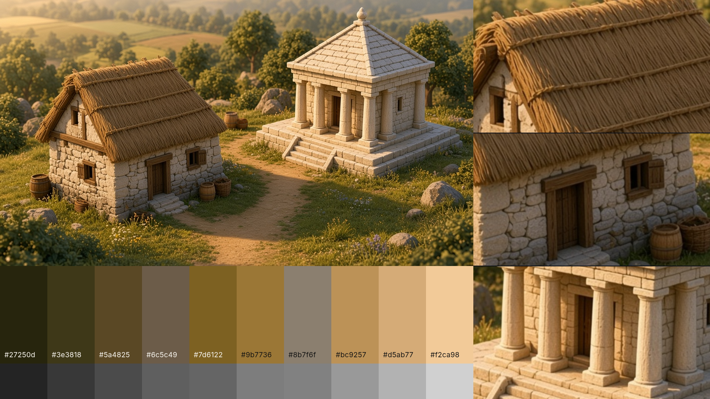

Hero: [`hero-buildings-40m.png`](hero-buildings-40m.png) (1280 x 720). Camera: about 40 m, three-quarter, about 30° down.

### Prompt

**hero-buildings-40m.png** (aspect 16:9, reference image: hero-towns-300m.png)

```text
Concept art for a god game played on one small living planet, stylized realism: clean readable shapes grouped into a few large deliberate forms, simplified but believable materials with clean joints and gentle edge highlights, a controlled palette slightly richer than real life but never neon, roofs, walls, ground and vegetation in clearly separate value bands, lifted clean shadows, physically lit. A close view from about 40 metres at a three-quarter angle looking down 30 degrees at two buildings of the Iron Age town in the reference image: on the left one house of whitewashed rubble stone with large simple stones and clean mortar joints, a dark timber door and two small shuttered windows, a steep golden reed-thatch roof with visible bundled thatch courses, sitting on a stone plinth that steps down a gently sloping grassy bank; on the right the pale cream limestone temple with four plain columns, a porch, dressed stone courses, and a light grey stone-slab roof. A packed-earth path between them, a few barrels and baskets, wild flowers in the grass. The house is about 400 pixels wide. Golden-hour low sun from the left with long soft shadows, soft atmospheric haze toward the distance, crisp detail, every roof, wall and ground reads as a distinct shape and colour. No photo-scan grit, no outlines, not cartoonish, not toy-like. No text, no labels, no watermark, no UI.
```

### Detail crops (top to bottom; 320 x 180 px of the hero shown at 2x)

1. Hero x 170-490, y 170-350: Thatch: courses of bundled straw read as a few large bands with a clean ridge and eave line, not noise (quality 1, 4).
2. Hero x 300-620, y 370-550: Fieldstone wall, timber door and window: individual stones with clean joints and soft edge highlights, plinth stepping on the slope (quality 4).
3. Hero x 760-1080, y 220-400: Civic building of dressed limestone: columns, cornice and stepped base read as big shapes; lightest object in the frame (quality 1, 2).

### Palette (k-means, 10 clusters, median sRGB of each cluster, darkest to lightest)

| Hex | Share of frame | Luminance Y |
|---|---|---|
| `#27250d` | 7.0 % | 0.018 |
| `#3e3818` | 15.3 % | 0.039 |
| `#5a4825` | 18.3 % | 0.069 |
| `#6c5c49` | 10.7 % | 0.113 |
| `#7d6122` | 11.7 % | 0.13 |
| `#9b7736` | 9.8 % | 0.204 |
| `#8b7f6f` | 6.8 % | 0.218 |
| `#bc9257` | 8.6 % | 0.319 |
| `#d5ab77` | 7.2 % | 0.446 |
| `#f2ca98` | 4.5 % | 0.634 |

### Greyscale check (24 x 24 px median samples)

| Material | Hero x, y | sRGB | L* |
|---|---|---|---|
| roof (thatch) | 375, 290 | `#574027` | 28.9 |
| wall (whitewash) | 200, 450 | `#deb07c` | 74.8 |
| ground (grass) | 1000, 560 | `#383a18` | 23.3 |
| path | 690, 640 | `#775c41` | 41.2 |
| vegetation (trees) | 640, 120 | `#604f19` | 34.2 |

**Result: reads by shape, partial by value.** The greyscale version (greyscale-check.png) reads: roofs, walls, ground and vegetation are told apart by shape, edge shadow and texture. Flat value bands overlap (ΔL* under 10) for: roof (thatch) / ground (grass) (ΔL* 5.6); roof (thatch) / vegetation (trees) (ΔL* 5.3); path / vegetation (trees) (ΔL* 7.0).

### Checkable statements

- The whitewashed or dressed-stone wall is at least 30 L* lighter than the thatch roof above it (measured 74.8 vs 28.9).
- Individual stone courses and thatch courses are visible on a house that spans about 40 % of the frame width.
- No texture repeat visible along any 10 m wall: no two stones in a row share the same shape and shading.
- Shadows fall to the right of objects (sun from the left) and are lifted: no shadow pixel darker than about L* 10 in the lit ground area.
- The civic building is the lightest large shape in the frame.

### Known misses

House is about 520 px wide in the 1280 px hero (about 780 px at 1080p), wider than the 300-500 px target: the camera is closer than 40 m. Thatch roof (L* 28.9) and the tree crowns behind it (34.2) are close in value; they separate by edge and hue, not by band.

## buildings-300m

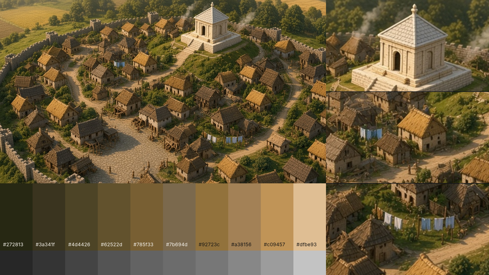

Hero: [`hero-buildings-300m.png`](hero-buildings-300m.png) (1280 x 720). Camera: about 300 m, 45° down.

### Prompt

**hero-buildings-300m.png** (aspect 16:9, reference image: hero-towns-300m.png)

```text
Concept art for a god game played on one small living planet, stylized realism: clean readable shapes grouped into a few large deliberate forms, simplified but believable materials, a controlled palette slightly richer than real life but never neon, roofs, walls, ground and vegetation in clearly separate value bands, lifted clean shadows, physically lit. A strategy view from about 300 metres, looking down at 45 degrees, closer in on one street block of the Iron Age town in the reference image: about thirty houses along two packed-earth lanes, each house with a clearly shaped gable roof of either bright golden reed thatch or dark brown wooden shingles over whitewashed stone or warm ochre mudbrick walls, small yards with laundry lines, woodpiles and a cart, the cobbled market square at one corner, and the pale cream limestone temple with a light grey roof standing out as the lightest and most distinct roof in frame, part of the grey stone ring wall with a square tower along one edge. Houses are about 40 pixels across. Golden-hour low sun from the left with long soft shadows, crisp detail, every roof, wall and lane reads as a distinct shape and colour. No photo-scan grit, no outlines, not cartoonish, not toy-like. No text, no labels, no watermark, no UI.
```

### Detail crops (top to bottom; 320 x 180 px of the hero shown at 2x)

1. Hero x 660-980, y 0-180: The temple: the lightest roof and the only white mass in the block, readable as a landmark at a glance (target: temple is the most distinct roof).
2. Hero x 380-700, y 170-350: Thatch vs shingle roofs: two roof colours (gold thatch, dark brown shingle) with hip and gable shapes clear at about 70 px per house.
3. Hero x 700-1020, y 470-650: Life and use: laundry lines, yards, worn paths between houses (quality 6).

### Palette (k-means, 10 clusters, median sRGB of each cluster, darkest to lightest)

| Hex | Share of frame | Luminance Y |
|---|---|---|
| `#272813` | 13.1 % | 0.02 |
| `#3a341f` | 20.0 % | 0.035 |
| `#4d4426` | 16.6 % | 0.059 |
| `#62522d` | 13.3 % | 0.088 |
| `#785f33` | 9.6 % | 0.124 |
| `#7b694d` | 3.7 % | 0.148 |
| `#92723c` | 7.1 % | 0.185 |
| `#a38156` | 7.9 % | 0.242 |
| `#c09457` | 7.1 % | 0.331 |
| `#dfbe93` | 1.5 % | 0.546 |

### Greyscale check (24 x 24 px median samples)

| Material | Hero x, y | sRGB | L* |
|---|---|---|---|
| roof (thatch) | 559, 240 | `#c4893e` | 61.7 |
| roof (shingle) | 316, 489 | `#373128` | 20.8 |
| wall (whitewash) | 601, 451 | `#85623d` | 44.4 |
| ground (lane) | 520, 640 | `#a98860` | 58.9 |
| vegetation | 1050, 60 | `#414023` | 26.4 |

**Result: reads by shape, partial by value.** The greyscale version (greyscale-check.png) reads: roofs, walls, ground and vegetation are told apart by shape, edge shadow and texture. Flat value bands overlap (ΔL* under 10) for: roof (thatch) / ground (lane) (ΔL* 2.8); roof (shingle) / vegetation (ΔL* 5.6).

### Checkable statements

- The temple roof is the lightest roof in frame (pale stone vs gold thatch and dark shingle).
- Thatch roofs and shingle roofs differ by at least 30 L* (measured 61.7 vs 20.8).
- Every house roof shows its ridge line and at least two roof planes with different brightness (sun-side vs shade-side).
- Lanes form a connected network; the cobbled square is the brightest open ground.
- At least two signs of use per block (laundry, smoke, carts, yards).

### Known misses

Houses are about 60-75 px wide in the 1280 px hero, larger than the 40 px target: the camera is closer than 300 m. The sunlit cobbled lane (L* 58.9) is almost as light as the thatch (61.7); they separate by texture and shadow, not by value band.

## buildings-2km

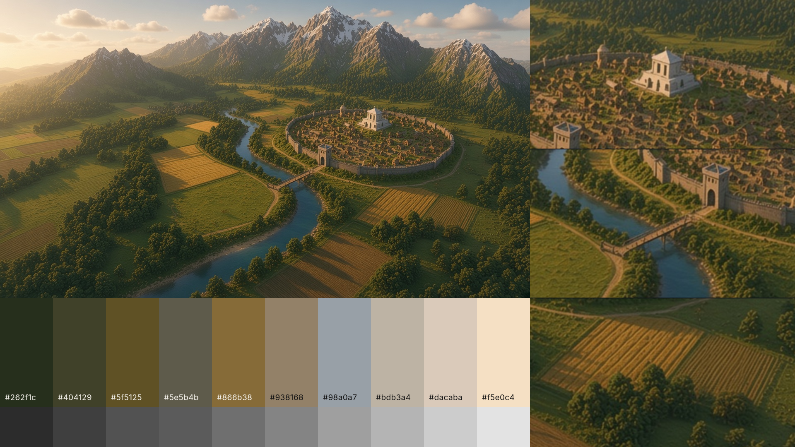

Hero: [`hero-buildings-2km.png`](hero-buildings-2km.png) (1280 x 720). Camera: about 2 km, about 35-40° down (shallower than the 45-55° asked).

### Prompt

**hero-buildings-2km.png** (aspect 16:9, reference image: hero-terrain-2km.png)

```text
Concept art for a god game played on one small living planet, stylized realism: clean readable shapes, simplified but believable materials, a controlled palette slightly richer than real life but never neon, distinct value bands, lifted clean shadows, physically lit. A very high oblique aerial view from about 2 kilometres away, looking down at 50 degrees, over the same valley as the reference image, centred on the round walled Iron Age town by the river, which fills only about a quarter of the frame width: individual houses are tiny, about 8 pixels across, so the town reads as fields of roof colour, warm golden thatch patches and dark brown shingle patches, inside the thin grey circle of the ring wall; landmarks still identifiable by silhouette alone and their long shadows: the bright white limestone temple block on its rise, the square towers of the wall and the tall gatehouse, a tall smoking forge chimney outside the gate, a timber bridge, roads leaving the gates, around it a wide quilt of gold, green and brown fields, dark woods and the winding blue-green river. Golden-hour low sun from the left with long soft shadows, soft atmospheric haze toward the distance, crisp detail. No photo-scan grit, no outlines, not cartoonish. No text, no labels, no watermark, no UI.
```

### Detail crops (top to bottom; 320 x 180 px of the hero shown at 2x)

1. Hero x 740-1060, y 200-380: Town silhouette: the temple and the ring wall towers still read by shape alone at this distance (target: landmarks by silhouette).
2. Hero x 560-880, y 330-510: Gatehouse, bridge and road: the road line that links the town to the river crossing carries through from the 300 m boards (quality 7).
3. Hero x 850-1170, y 430-610: Farmland quilt: stripes and plots in several stages, gold, green and ploughed (qualities 6, 7).

### Palette (k-means, 10 clusters, median sRGB of each cluster, darkest to lightest)

| Hex | Share of frame | Luminance Y |
|---|---|---|
| `#262f1c` | 21.1 % | 0.025 |
| `#404129` | 24.7 % | 0.05 |
| `#5f5125` | 17.1 % | 0.085 |
| `#5e5b4b` | 10.2 % | 0.104 |
| `#866b38` | 7.0 % | 0.159 |
| `#938168` | 4.6 % | 0.229 |
| `#98a0a7` | 3.9 % | 0.346 |
| `#bdb3a4` | 4.3 % | 0.457 |
| `#dacaba` | 3.2 % | 0.607 |
| `#f5e0c4` | 3.9 % | 0.767 |

### Greyscale check (24 x 24 px median samples)

| Material | Hero x, y | sRGB | L* |
|---|---|---|---|
| roof field (town) | 870, 320 | `#564828` | 31.3 |
| wall (ring) | 1000, 395 | `#4c412f` | 28.1 |
| ground (field) | 450, 420 | `#a8752d` | 53.2 |
| vegetation (forest) | 220, 560 | `#262e1d` | 17.9 |
| water (sky reflection) | 560, 600 | `#534d3e` | 32.9 |

**Result: reads by shape, partial by value.** The greyscale version (greyscale-check.png) reads: roofs, walls, ground and vegetation are told apart by shape, edge shadow and texture. Flat value bands overlap (ΔL* under 10) for: roof field (town) / wall (ring) (ΔL* 3.2); roof field (town) / water (sky reflection) (ΔL* 1.6); wall (ring) / water (sky reflection) (ΔL* 4.8).

### Checkable statements

- Houses are about 4-8 px wide; the temple is identifiable by its white block and pyramidal roof.
- The town reads as one warm-brown cluster inside a grey ring wall.
- Fields are at least three different colours (gold, green, brown) with straight edges.
- The river is the only blue element and is darker than the fields around it.

### Known misses

The camera looks shallower (about 35-40°) with mountains and a horizon, closer to a 30-40° oblique than 45-55°. Composition is nearly the same as terrain-2km because that image was the reference. The town roof field (L* 31.3) is close to the wall (28.1) and the river (32.9).

## terrain-40m

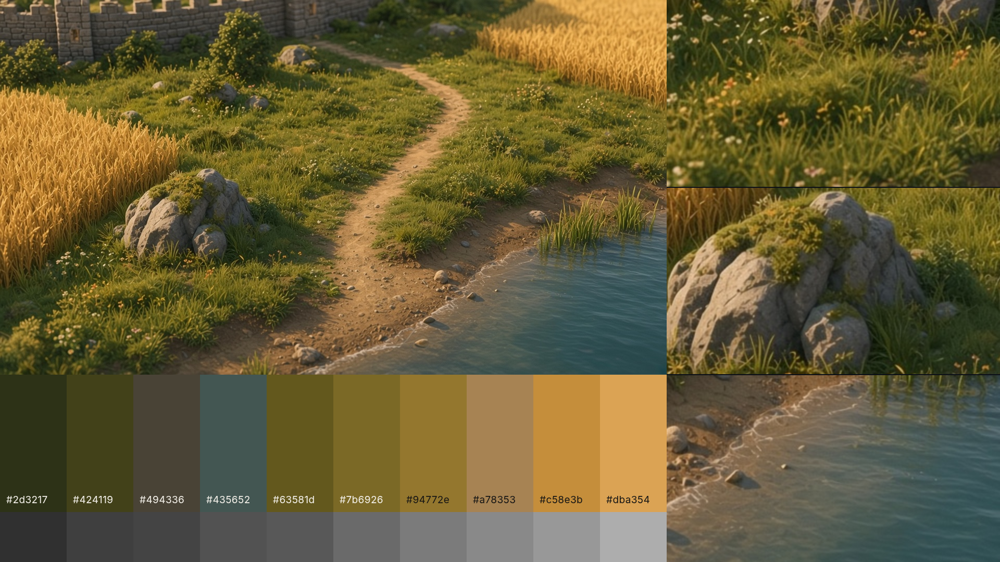

Hero: [`hero-terrain-40m.png`](hero-terrain-40m.png) (1280 x 720). Camera: about 40 m, about 30° down.

### Prompt

**hero-terrain-40m.png** (aspect 16:9, reference image: hero-towns-300m.png)

```text
Concept art for a god game played on one small living planet, stylized realism: clean readable shapes, simplified but believable materials, a controlled palette slightly richer than real life but never neon, distinct value bands, lifted clean shadows, physically lit. A close view from about 40 metres looking down at 30 degrees at the ground just outside the edge of the Iron Age town in the reference image, with only the corner of the grey stone ring wall at the top edge: rich green meadow grass in calm soft clumps with a few wild flowers, a worn packed-earth footpath with small scattered pebbles curving through it, the edge of a ripe golden wheat field with a clean irregular boundary, a grey rock outcrop with moss and lichen, and a river bank with damp darker earth, reeds and a clean bright rim where it meets clear blue-green water. Blends between grass, earth, rock and sand are soft and irregular, no repeating pattern anywhere. Golden-hour low sun from the left with long soft shadows, crisp detail. No photo-scan grit, no outlines, not cartoonish, not toy-like. No text, no labels, no watermark, no UI.
```

### Detail crops (top to bottom; 320 x 180 px of the hero shown at 2x)

1. Hero x 120-440, y 470-650: Grass clumps: blades grouped into clumps with calm variation; no repeat pattern (target: visible but calm).
2. Hero x 240-560, y 320-500: Rock outcrop and path: rounded boulder with grass on top, path with a few pebbles; soft irregular blend from path to grass.
3. Hero x 840-1160, y 470-650: River bank: a clean bright rim of wet sand and pebbles between grass and water.

### Palette (k-means, 10 clusters, median sRGB of each cluster, darkest to lightest)

| Hex | Share of frame | Luminance Y |
|---|---|---|
| `#2d3217` | 12.9 % | 0.029 |
| `#424119` | 11.7 % | 0.05 |
| `#494336` | 9.3 % | 0.057 |
| `#435652` | 10.9 % | 0.085 |
| `#63581d` | 14.1 % | 0.097 |
| `#7b6926` | 17.3 % | 0.145 |
| `#94772e` | 9.6 % | 0.197 |
| `#a78353` | 4.5 % | 0.251 |
| `#c58e3b` | 5.0 % | 0.315 |
| `#dba354` | 4.6 % | 0.419 |

### Greyscale check (24 x 24 px median samples)

| Material | Hero x, y | sRGB | L* |
|---|---|---|---|
| grass | 300, 600 | `#625c1b` | 38.4 |
| path | 690, 560 | `#b88a54` | 60.8 |
| rock | 320, 430 | `#a68b6c` | 59.6 |
| wheat | 90, 360 | `#a97228` | 52.6 |
| water | 1000, 640 | `#455650` | 35.0 |

**Result: reads by shape, partial by value.** The greyscale version (greyscale-check.png) reads: roofs, walls, ground and vegetation are told apart by shape, edge shadow and texture. Flat value bands overlap (ΔL* under 10) for: grass / water (ΔL* 3.4); path / rock (ΔL* 1.2); path / wheat (ΔL* 8.2); rock / wheat (ΔL* 7.0).

### Checkable statements

- No ground pattern repeats anywhere in frame (compare with the tiling failure in do-and-dont.png).
- The path is at least 20 L* lighter than the grass beside it (measured 60.8 vs 38.4).
- Grass to path and grass to field edges are irregular and soft, never a straight hard line.
- Water is darker than all land materials next to it (measured L* 35.0).
- Pebbles on the path are sparse: at most a few per square metre.

### Known misses

Path (L* 60.8) and the lit rock (59.6) are close in value; they separate by shape and shadow.

## terrain-300m

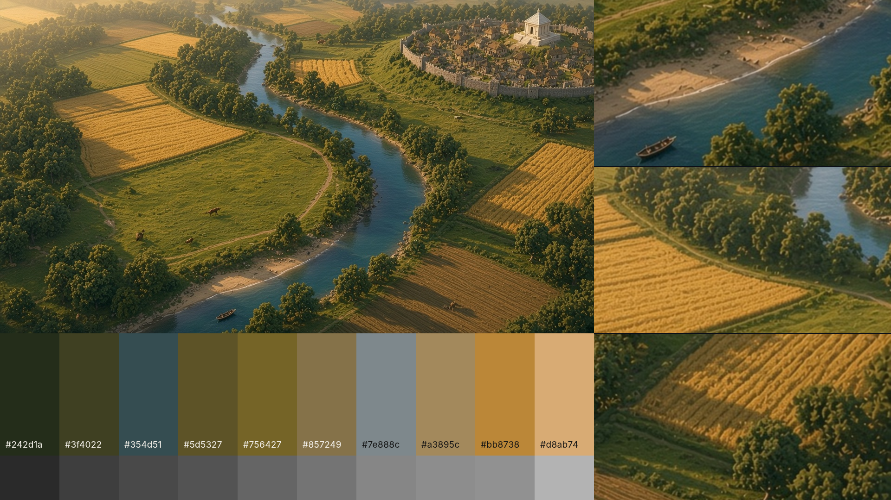

Hero: [`hero-terrain-300m.png`](hero-terrain-300m.png) (1280 x 720). Camera: about 300 m, 45° down.

### Prompt

**hero-terrain-300m.png** (aspect 16:9, reference image: hero-towns-300m.png)

```text
Concept art for a god game played on one small living planet, stylized realism: clean readable shapes, simplified but believable materials, a controlled palette slightly richer than real life but never neon, distinct value bands, lifted clean shadows, physically lit. A strategy view from about 300 metres looking down at 45 degrees at the valley floor beside the Iron Age town in the reference image, with the town wall just visible at one corner: open green meadows, the dark green edge of an oak forest with individual rounded tree crowns, long fields in stripes of gold, green and ploughed brown separated by hedges, the deep blue-green river darker and more saturated than the land, winding to a pale sandy beach with a clean bright shoreline rim, a dirt track and a few grazing cattle. Field stripes and forest crowns read as calm texture, not noise. Golden-hour low sun from the left with long soft shadows, soft atmospheric haze toward the distance, crisp detail. No photo-scan grit, no outlines, not cartoonish, not toy-like. No text, no labels, no watermark, no UI.
```

### Detail crops (top to bottom; 320 x 180 px of the hero shown at 2x)

1. Hero x 420-740, y 520-700: River and beach: the shoreline is a clean bright sand rim; the river is darker and more saturated than the land.
2. Hero x 300-620, y 150-330: Forest crowns: individual tree crowns read as rounded texture, grouped in clumps, not noise.
3. Hero x 960-1280, y 380-560: Field stripes: ploughed and ripe strips read as regular texture with soft variation.

### Palette (k-means, 10 clusters, median sRGB of each cluster, darkest to lightest)

| Hex | Share of frame | Luminance Y |
|---|---|---|
| `#242d1a` | 16.9 % | 0.023 |
| `#3f4022` | 18.4 % | 0.048 |
| `#354d51` | 5.8 % | 0.067 |
| `#5d5327` | 18.9 % | 0.087 |
| `#756427` | 17.8 % | 0.13 |
| `#857249` | 8.9 % | 0.175 |
| `#7e888c` | 0.8 % | 0.241 |
| `#a3895c` | 4.8 % | 0.265 |
| `#bb8738` | 5.7 % | 0.282 |
| `#d8ab74` | 2.0 % | 0.45 |

### Greyscale check (24 x 24 px median samples)

| Material | Hero x, y | sRGB | L* |
|---|---|---|---|
| meadow | 500, 450 | `#6e6422` | 42.0 |
| forest | 110, 380 | `#202a1c` | 15.5 |
| field (gold) | 330, 280 | `#c38c39` | 62.3 |
| river | 770, 490 | `#333f3e` | 25.6 |
| beach | 520, 595 | `#78664b` | 44.2 |

**Result: reads by shape, partial by value.** The greyscale version (greyscale-check.png) reads: roofs, walls, ground and vegetation are told apart by shape, edge shadow and texture. Flat value bands overlap (ΔL* under 10) for: meadow / beach (ΔL* 2.2).

### Checkable statements

- The river is darker than every land material in frame (measured L* 25.6 vs meadow 42.0).
- The sand rim along the river is at least 15 L* lighter than the water.
- Forest is the darkest land material (measured L* 15.5) and has a visible crown texture.
- Ripe fields are the lightest land material (measured L* 62.3).

### Known misses

The beach in shadow (L* 44.2) sits near the meadow (42.0); the lit parts of the rim are lighter.

## terrain-2km

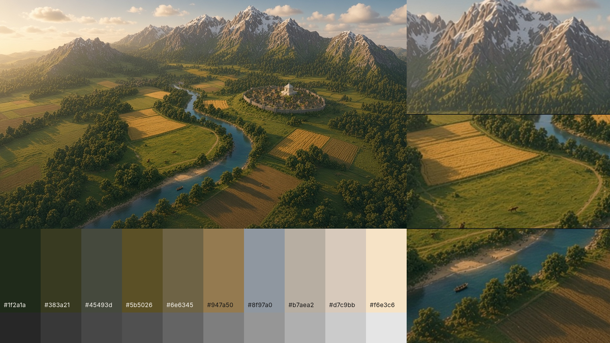

Hero: [`hero-terrain-2km.png`](hero-terrain-2km.png) (1280 x 720). Camera: about 2 km, about 35-40° down (shallower than the 50° asked).

### Prompt

**hero-terrain-2km.png** (aspect 16:9, reference image: hero-terrain-300m.png)

```text
Concept art for a god game played on one small living planet, stylized realism: clean readable shapes, simplified but believable materials, a controlled palette slightly richer than real life but never neon, distinct value bands, lifted clean shadows, physically lit. A high oblique view from about 2 kilometres looking down at 50 degrees across the same green river valley as the reference image, rising to mountains: a biome mosaic with large-scale variation at 100 to 500 metre scale, dark green broadleaf forest on the lower slopes, darker conifer forest higher up, open olive-green grassland, a farmland quilt of gold, green and brown fields with hedges on the valley floor, the blue-green river with pale gravel bars, grey rock ridges with scree fans, and a clean snow line on the high peaks, small cumulus clouds with their shadows on the ground. The small walled town is a tiny warm cluster near the river. No ground texture repeats anywhere. Muted natural greens and browns, slightly rich, like the planet seen from orbit. Golden-hour low sun from the left with long soft shadows, soft atmospheric haze toward the distance, crisp detail. No photo-scan grit, no outlines, not cartoonish. No text, no labels, no watermark, no UI.
```

### Detail crops (top to bottom; 320 x 180 px of the hero shown at 2x)

1. Hero x 650-970, y 30-210: Snow line and rock ridges: snow sits only on peaks, rock ridges catch the low sun (target: biome mosaic).
2. Hero x 380-700, y 330-510: Farmland quilt: plots 100-500 m across in several stages, the macro variation the brief asks for.
3. Hero x 480-800, y 500-680: Forest and river: forest blocks follow the river; the river is a darker blue line.

### Palette (k-means, 10 clusters, median sRGB of each cluster, darkest to lightest)

| Hex | Share of frame | Luminance Y |
|---|---|---|
| `#1f2a1a` | 15.9 % | 0.02 |
| `#383a21` | 19.1 % | 0.04 |
| `#45493d` | 10.8 % | 0.064 |
| `#5b5026` | 17.0 % | 0.081 |
| `#6e6345` | 12.5 % | 0.127 |
| `#947a50` | 7.3 % | 0.208 |
| `#8f97a0` | 3.8 % | 0.305 |
| `#b7aea2` | 5.1 % | 0.429 |
| `#d7c9bb` | 3.9 % | 0.598 |
| `#f6e3c6` | 4.5 % | 0.786 |

### Greyscale check (24 x 24 px median samples)

| Material | Hero x, y | sRGB | L* |
|---|---|---|---|
| snow (shade side) | 800, 50 | `#68676a` | 43.8 |
| rock ridge | 900, 150 | `#685d43` | 39.9 |
| forest | 300, 520 | `#1c271a` | 14.4 |
| field (gold) | 470, 390 | `#ba8538` | 59.4 |
| meadow | 560, 470 | `#675f1e` | 39.9 |
| river | 690, 470 | `#413f18` | 26.2 |

**Result: reads by shape, partial by value.** The greyscale version (greyscale-check.png) reads: roofs, walls, ground and vegetation are told apart by shape, edge shadow and texture. Flat value bands overlap (ΔL* under 10) for: snow (shade side) / rock ridge (ΔL* 3.9); snow (shade side) / meadow (ΔL* 3.9); rock ridge / meadow (ΔL* 0.0).

### Checkable statements

- Macro variation at 100-500 m: no two neighbouring plots are the same colour.
- No ground texture repeats anywhere in frame.
- Forest is the darkest land material (measured L* 14.4); fields are the lightest (59.4).
- Snow appears only above the rock ridge line.
- The town with its ring wall and white temple is visible as a small landmark.

### Known misses

Shallower view than 50°, with sky and horizon. Rock ridge (L* 39.9) and meadow (39.9) match in value; they separate by hue and texture only. Not yet compared side by side with shots/ue-cloudlab-terminator-final.png.

## towns-40m

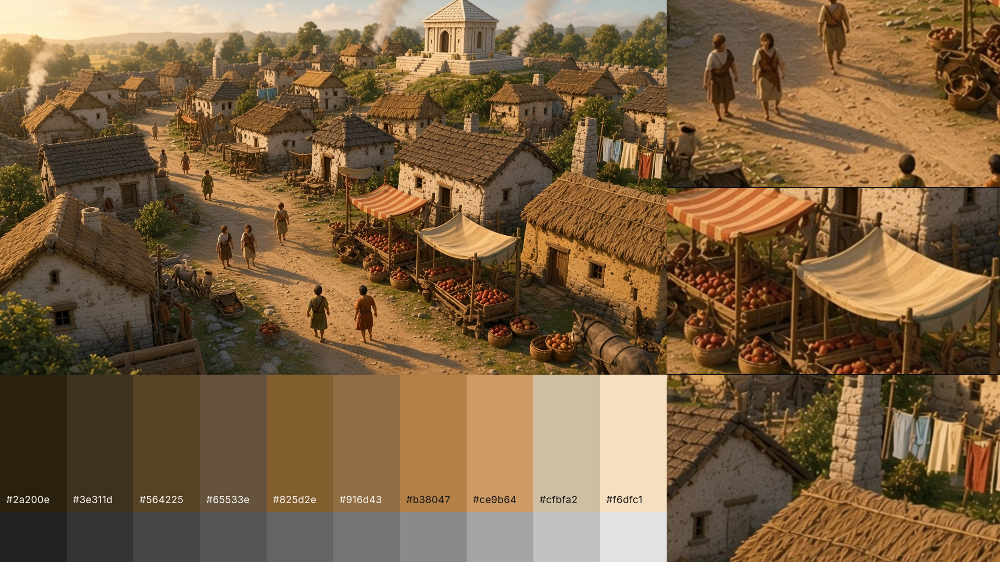

Hero: [`hero-towns-40m.png`](hero-towns-40m.png) (1280 x 720). Camera: about 40 m, about 30° down.

### Prompt

**hero-towns-40m.png** (aspect 16:9, reference image: hero-towns-300m.png)

```text
Concept art for a god game played on one small living planet, stylized realism: clean readable shapes, simplified but believable materials, a controlled palette slightly richer than real life but never neon, distinct value bands, lifted clean shadows, physically lit. A close view from about 40 metres, looking down 25 degrees, along a lane inside the Iron Age town in the reference image: whitewashed stone and ochre mudbrick houses with golden thatch and dark shingle roofs on both sides, a packed-earth lane with wheel ruts and a stone gutter, a small market with three stalls under striped saffron and undyed canvas awnings selling baskets of apples and pots, grouped together at one widening of the lane, a handcart, a donkey, a dozen people in undyed wool, ochre and madder-red tunics, readable by colour and silhouette, about 40 to 60 pixels tall, chimney smoke, laundry on a line between houses, the pale limestone temple porch at the end of the lane. Golden-hour low sun from the left with long soft shadows, soft haze, crisp detail. No photo-scan grit, no outlines, not cartoonish, not toy-like. No text, no signs, no labels, no watermark, no UI.
```

### Detail crops (top to bottom; 320 x 180 px of the hero shown at 2x)

1. Hero x 380-700, y 400-580: People: figures read by clothing colour and silhouette, walking on the lane.
2. Hero x 680-1000, y 370-550: Market stalls: striped awnings and baskets of produce grouped into one market cluster, not scattered evenly.
3. Hero x 940-1260, y 230-410: Laundry and chimney: signs that people live here (quality 6).

### Palette (k-means, 10 clusters, median sRGB of each cluster, darkest to lightest)

| Hex | Share of frame | Luminance Y |
|---|---|---|
| `#2a200e` | 10.5 % | 0.016 |
| `#3e311d` | 16.3 % | 0.033 |
| `#564225` | 15.5 % | 0.06 |
| `#65533e` | 13.1 % | 0.093 |
| `#825d2e` | 11.6 % | 0.128 |
| `#916d43` | 7.3 % | 0.174 |
| `#b38047` | 9.9 % | 0.255 |
| `#ce9b64` | 6.2 % | 0.375 |
| `#cfbfa2` | 4.8 % | 0.531 |
| `#f6dfc1` | 4.7 % | 0.762 |

### Greyscale check (24 x 24 px median samples)

| Material | Hero x, y | sRGB | L* |
|---|---|---|---|
| roof (thatch) | 170, 450 | `#4b3924` | 25.3 |
| roof (shingle) | 870, 300 | `#735233` | 37.7 |
| wall (whitewash) | 210, 590 | `#5e5449` | 36.4 |
| ground (lane) | 520, 520 | `#715842` | 39.4 |
| vegetation | 60, 600 | `#3e3a18` | 24.0 |

**Result: reads by shape, partial by value.** The greyscale version (greyscale-check.png) reads: roofs, walls, ground and vegetation are told apart by shape, edge shadow and texture. Flat value bands overlap (ΔL* under 10) for: roof (thatch) / vegetation (ΔL* 1.3); roof (shingle) / wall (whitewash) (ΔL* 1.3); roof (shingle) / ground (lane) (ΔL* 1.7); wall (whitewash) / ground (lane) (ΔL* 3.0).

### Checkable statements

- Figures are readable by silhouette and clothing colour against the lane.
- Props are grouped (market stalls together, barrels by doors), not spread evenly.
- At least three signs of life: smoke, laundry, carts or market goods.
- Shadows fall to the right of figures and buildings.

### Known misses

Figures are about 50-65 px tall in the 1280 px hero (about 75-95 px at 1080p), over the 30-60 px target: the camera is closer than 40 m. Value bands are compressed: thatch roof in shade (L* 25.3) and vegetation (24.0), and shingle roof (37.7), wall in shade (36.4) and lane (39.4) are close; they separate by shape, shadow and hue.

## towns-300m

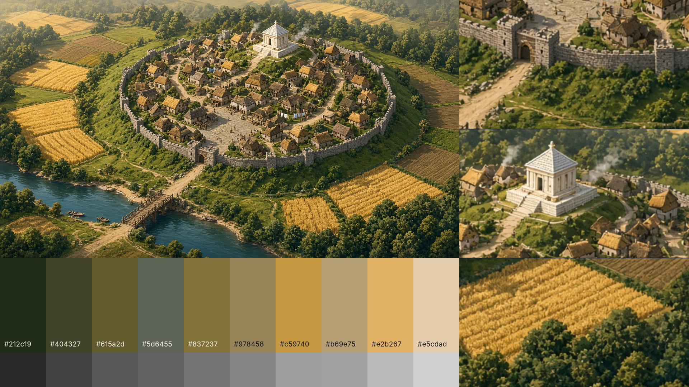

Hero: [`hero-towns-300m.png`](hero-towns-300m.png) (1280 x 720). Camera: about 300 m, 45° down.

### Prompt

**hero-towns-300m.png** (aspect 16:9, reference image: none)

```text
Concept art for a god game played on one small living planet, stylized realism: clean readable shapes grouped into a few large deliberate forms, simplified but believable materials with clean joints and gentle edge highlights, a controlled palette slightly richer than real life but never neon, roofs, walls, ground and vegetation in clearly separate value bands, lifted clean shadows, physically lit. A strategy view from about 300 metres away, looking down at 45 degrees, at a whole Iron Age river town of about eighty houses on a gentle rise in a green valley: bright golden reed-thatch roofs and dark chocolate-brown wooden-shingle roofs clearly contrasting with whitewashed stone and warm ochre mudbrick walls, a pale cream limestone temple with a light grey stone roof on a low rise as the lightest roof in frame, a round grey stone ring wall with square towers and a gatehouse, a clear network of light packed-earth lanes leading to one cobbled market square, thin smoke from a few chimneys, laundry lines, a timber bridge over a deep blue-green river with a clean sandy bank and small boats, outside the wall a patchwork of ripe gold, fresh green and ploughed brown fields with dark hedges and worn footpaths, rich green meadows, dark green oak woods at the edges. Houses are about 40 pixels across. Golden-hour low sun from the left with long soft shadows, soft atmospheric haze toward the distance, crisp detail, every roof, wall, road and field reads as a distinct shape and colour. No photo-scan grit, no outlines, not cartoonish, not toy-like, not beige-on-beige. No text, no labels, no watermark, no UI.
```

### Detail crops (top to bottom; 320 x 180 px of the hero shown at 2x)

1. Hero x 470-790, y 370-550: Wall and gate: the ring wall and gatehouse define the town edge in under a second.
2. Hero x 640-960, y 40-220: Temple: the white civic building on the plaza is the landmark and the lightest roof.
3. Hero x 950-1270, y 470-650: Fields outside: ripe gold strips and green fields ring the town (quality 7).

### Palette (k-means, 10 clusters, median sRGB of each cluster, darkest to lightest)

| Hex | Share of frame | Luminance Y |
|---|---|---|
| `#212c19` | 16.3 % | 0.022 |
| `#404327` | 20.2 % | 0.053 |
| `#615a2d` | 16.9 % | 0.1 |
| `#5d6455` | 6.8 % | 0.121 |
| `#837237` | 13.2 % | 0.171 |
| `#978458` | 9.7 % | 0.238 |
| `#c59740` | 6.0 % | 0.344 |
| `#b69e75` | 5.8 % | 0.357 |
| `#e2b267` | 4.6 % | 0.49 |
| `#e5cdad` | 0.6 % | 0.633 |

### Greyscale check (24 x 24 px median samples)

| Material | Hero x, y | sRGB | L* |
|---|---|---|---|
| roof (thatch) | 480, 285 | `#e0ab59` | 73.4 |
| roof (shingle) | 545, 400 | `#675441` | 37.3 |
| wall (ring) | 760, 440 | `#554f44` | 33.8 |
| ground (lane) | 620, 390 | `#b99e7a` | 66.7 |
| vegetation (meadow) | 300, 420 | `#645e27` | 39.6 |
| field (gold) | 150, 220 | `#e7b352` | 75.9 |

**Result: reads by shape, partial by value.** The greyscale version (greyscale-check.png) reads: roofs, walls, ground and vegetation are told apart by shape, edge shadow and texture. Flat value bands overlap (ΔL* under 10) for: roof (thatch) / ground (lane) (ΔL* 6.7); roof (thatch) / field (gold) (ΔL* 2.6); roof (shingle) / wall (ring) (ΔL* 3.5); roof (shingle) / vegetation (meadow) (ΔL* 2.3); wall (ring) / vegetation (meadow) (ΔL* 5.8); ground (lane) / field (gold) (ΔL* 9.3).

### Checkable statements

- The ring wall reads as one continuous grey line around the town.
- Lanes form a connected network leading to one central plaza.
- The temple is the lightest building in frame.
- Thatch roofs are at least 30 L* lighter than shingle roofs (measured 73.4 vs 37.3).
- Fields outside the wall are at least two colours (gold, green) with straight edges.

### Known misses

Shingle roofs (L* 37.3), the wall (33.8) and the meadow (39.6) are close; they separate by hue and edge shadow. Houses are about 25-35 px in the 1280 px hero.

## towns-2km

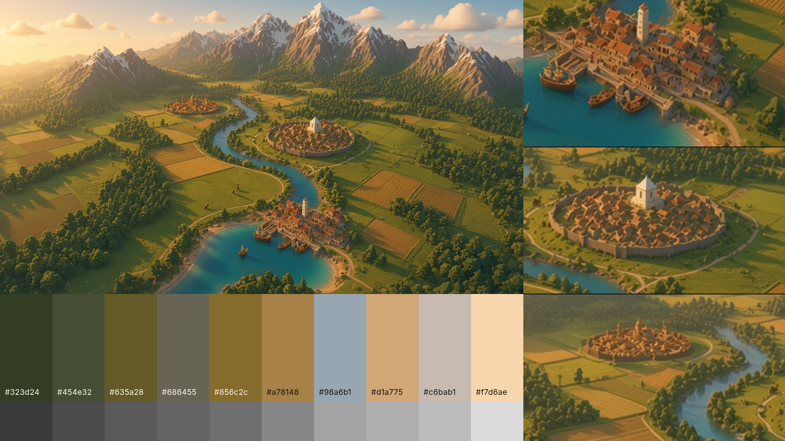

Hero: [`hero-towns-2km.png`](hero-towns-2km.png) (1280 x 720). Camera: about 2 km, about 35-40° down (shallower than the 50° asked).

### Prompt

**hero-towns-2km.png** (aspect 16:9, reference image: hero-terrain-2km.png)

```text
Concept art for a god game played on one small living planet, stylized realism: clean readable shapes, simplified but believable materials, a controlled palette slightly richer than real life but never neon, distinct value bands, lifted clean shadows, physically lit. A very high oblique aerial view from about 2 kilometres away, looking down at 50 degrees, along the same green river valley as the reference image, wide enough that houses are tiny, about 8 pixels across. Three settlements of different sizes and ages, each small in the frame: in the middle the round walled Iron Age town as a warm cluster of golden and brown roofs with its bright white temple mark; far upstream a small Bronze Age village of straw-coloured roofs inside a palisade with a small mound shrine; downstream where the river opens into a turquoise bay a larger harbour town of terracotta roofs with a pale stone lighthouse and tiny sailing ships. Each reads as a coloured cluster with one landmark, thin pale roads link them along the river, and each is ringed by its own quilt of gold, green and brown fields, the biggest quilt around the biggest town, with dark woods and grey rock ridges between. Golden-hour low sun from the left with long soft shadows, soft atmospheric haze toward the distance, crisp detail. No photo-scan grit, no outlines, not cartoonish. No text, no labels, no watermark, no UI.
```

### Detail crops (top to bottom; 320 x 180 px of the hero shown at 2x)

1. Hero x 600-920, y 480-660: Harbour town: the largest and youngest town, terracotta roofs and a tower, by the lake.
2. Hero x 620-940, y 250-430: Iron-age ring town with its white temple: the same town as towns-300m.
3. Hero x 330-650, y 200-380: Small Bronze-age village: a round cluster of brown huts.

### Palette (k-means, 10 clusters, median sRGB of each cluster, darkest to lightest)

| Hex | Share of frame | Luminance Y |
|---|---|---|
| `#323d24` | 17.8 % | 0.041 |
| `#454e32` | 13.8 % | 0.069 |
| `#635a28` | 20.2 % | 0.101 |
| `#686455` | 8.7 % | 0.127 |
| `#856c2c` | 14.7 % | 0.159 |
| `#a78148` | 7.5 % | 0.244 |
| `#98a6b1` | 3.5 % | 0.371 |
| `#d1a775` | 2.1 % | 0.425 |
| `#c6bab1` | 5.1 % | 0.505 |
| `#f7d6ae` | 6.7 % | 0.709 |

### Greyscale check (24 x 24 px median samples)

| Material | Hero x, y | sRGB | L* |
|---|---|---|---|
| roofs (iron town) | 770, 330 | `#756138` | 42.2 |
| roofs (harbour) | 750, 550 | `#764c2e` | 36.4 |
| ground (meadow) | 560, 450 | `#816f20` | 47.1 |
| field (gold) | 960, 470 | `#956624` | 47.1 |
| forest | 250, 470 | `#535025` | 33.4 |
| water | 620, 650 | `#1b5b5d` | 35.0 |

**Result: reads by shape, partial by value.** The greyscale version (greyscale-check.png) reads: roofs, walls, ground and vegetation are told apart by shape, edge shadow and texture. Flat value bands overlap (ΔL* under 10) for: roofs (iron town) / roofs (harbour) (ΔL* 5.8); roofs (iron town) / ground (meadow) (ΔL* 5.0); roofs (iron town) / field (gold) (ΔL* 5.0); roofs (iron town) / forest (ΔL* 8.8); roofs (iron town) / water (ΔL* 7.2); roofs (harbour) / forest (ΔL* 3.0); roofs (harbour) / water (ΔL* 1.4); ground (meadow) / field (gold) (ΔL* 0.0); forest / water (ΔL* 1.7).

### Checkable statements

- Three towns of different sizes, each a distinct coloured cluster with a landmark.
- A road or the river links the three towns.
- Farmland surrounds each town.
- The lake is the most saturated blue and darker than the land around it.

### Known misses

Shallower view with horizon; the ships in the harbour are oversized for 2 km; the harbour town leans toy-like. Meadow and gold field are the same value (L* 47.1).

## night-300m

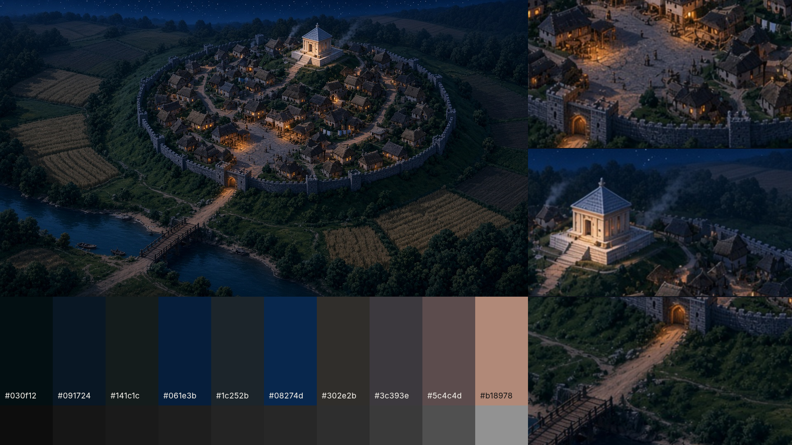

Hero: [`hero-night-300m.png`](hero-night-300m.png) (1280 x 720). Camera: about 300 m, 45° down, night.

### Prompt

**hero-night-300m.png** (aspect 16:9, reference image: hero-towns-300m.png)

```text
The exact same Iron Age walled river town, camera and composition as the reference image, but at night under a dim blue moonlight: warm orange window glows in many houses, small pools of warm torch and lamp light along the lanes, in the cobbled square and at the gatehouse, a brighter warm glow at the limestone temple, the dark roofs still clearly separated from the slightly lighter ground and lanes by moonlit edges, the river reflecting moonlight and a few lamps, fields and woods outside in deep blue-grey, thin chimney smoke lit from below, a starry deep-blue sky glow at the top. Stylized realism, clean readable shapes, controlled palette, physically lit. No text, no labels, no watermark, no UI.
```

### Detail crops (top to bottom; 320 x 180 px of the hero shown at 2x)

1. Hero x 500-820, y 290-470: Lamplit plaza: warm lamp pools on the paving with windows glowing around it.
2. Hero x 680-1000, y 20-200: Temple lit from the front: the landmark holds at night.
3. Hero x 380-700, y 420-600: Gate and bridge: dark roofs still separate from the ground; the road line carries through.

### Palette (k-means, 10 clusters, median sRGB of each cluster, darkest to lightest)

| Hex | Share of frame | Luminance Y |
|---|---|---|
| `#030f12` | 24.7 % | 0.004 |
| `#091724` | 13.7 % | 0.008 |
| `#141c1c` | 19.5 % | 0.011 |
| `#061e3b` | 5.6 % | 0.013 |
| `#1c252b` | 13.4 % | 0.017 |
| `#08274d` | 4.4 % | 0.02 |
| `#302e2b` | 9.4 % | 0.028 |
| `#3c393e` | 6.2 % | 0.042 |
| `#5c4c4d` | 2.7 % | 0.08 |
| `#b18978` | 0.4 % | 0.287 |

### Greyscale check (24 x 24 px median samples)

| Material | Hero x, y | sRGB | L* |
|---|---|---|---|
| lamplit square | 625, 352 | `#4c454a` | 30.2 |
| temple (lit) | 768, 110 | `#a3785a` | 54.0 |
| field | 125, 336 | `#35322e` | 20.8 |
| forest | 62, 656 | `#161e1d` | 10.6 |
| river | 125, 516 | `#071c32` | 9.8 |

**Result: reads by shape, partial by value.** The greyscale version (greyscale-check.png) reads: roofs, walls, ground and vegetation are told apart by shape, edge shadow and texture. Flat value bands overlap (ΔL* under 10) for: lamplit square / field (ΔL* 9.3); forest / river (ΔL* 0.8).

### Checkable statements

- Warm window and lamp colours (orange) are the only warm hues in frame.
- Roofs stay darker than the lamplit ground next to them.
- The temple is the brightest building.
- The ring wall and the river are still traceable.

### Known misses

Forest (L* 10.6) and river (9.8) merge at night; the river reads only by reflections.

## ages-300m.png

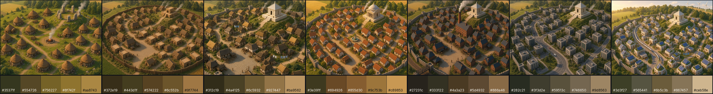

Seven 300 m panels in one row, left to right: **Stone, Bronze, Iron, Sail, Industry, Atomic, Space**. It is the
same street corner and temple plaza in each, rebuilt by each age, so the signature palettes sit side by side.
Under each panel is its own 5-swatch palette with hex codes. The Iron panel is a 4:3 centre crop of
`hero-buildings-300m.png`. The other six were generated with that hero as the reference:

**src/age-0-stone.jpg (Stone)** (aspect 4:3, reference image: hero-buildings-300m.png)

```text
Concept art for a god game, stylized realism: clean readable shapes, simplified but believable materials, a controlled palette slightly richer than real life but never neon, distinct value bands, physically lit. A strategy view from about 300 metres looking down at 45 degrees at the same street corner and lane layout as the reference image, but in the Stone Age: the lanes are worn footpaths in grass, the houses are a loose ring of round domed huts of bent poles covered in brown hides and pale straw thatch, drying racks, a central fire pit with smoke where the square was, a ring of standing stones where the temple was, wild meadow and forest edge, no walls, no fields. Signature palette: warm hide brown, straw, smoke grey and saturated grass green. Golden-hour low sun from the left with long soft shadows, crisp detail. No photo-scan grit, no outlines, not cartoonish. No text, no labels, no watermark, no UI.
```

**src/age-1-bronze.jpg (Bronze)** (aspect 4:3, reference image: hero-buildings-300m.png)

```text
Concept art for a god game, stylized realism: clean readable shapes, simplified but believable materials, a controlled palette slightly richer than real life but never neon, distinct value bands, physically lit. A strategy view from about 300 metres looking down at 45 degrees at the same street corner and lane layout as the reference image, but in the Bronze Age: rectangular mud-brick and timber houses with steep warm straw thatch and flat clay roofs, a small stepped mud-brick temple platform where the temple was, round clay granaries, a wooden palisade along one edge, dirt lanes, small fields of barley. Signature palette: warm straw and ochre, tan mud-brick, pale clay and green. Golden-hour low sun from the left with long soft shadows, crisp detail. No photo-scan grit, no outlines, not cartoonish. No text, no labels, no watermark, no UI.
```

**src/age-3-sail.jpg (Sail)** (aspect 4:3, reference image: hero-buildings-300m.png)

```text
Concept art for a god game, stylized realism: clean readable shapes, simplified but believable materials, a controlled palette slightly richer than real life but never neon, distinct value bands, physically lit. A strategy view from about 300 metres looking down at 45 degrees at the same street corner and lane layout as the reference image, but in the Sail Age: dense blocks of whitewashed plastered houses with bright terracotta tile roofs on a regular street grid, a domed temple with a portico where the temple was, a paved square with a fountain, the old grey wall kept along one edge, a few orange trees in courtyards. Signature palette: terracotta and whitewash, with pale stone and deep green. Golden-hour low sun from the left with long soft shadows, crisp detail. No photo-scan grit, no outlines, not cartoonish. No text, no labels, no watermark, no UI.
```

**src/age-4-industry.jpg (Industry)** (aspect 4:3, reference image: hero-buildings-300m.png)

```text
Concept art for a god game, stylized realism: clean readable shapes, simplified but believable materials, a controlled palette slightly richer than real life but never neon, distinct value bands, physically lit. A strategy view from about 300 metres looking down at 45 degrees at the same street corner and lane layout as the reference image, but in the Industry Age: rows of red-brown brick terraced houses with dark blue-grey slate roofs, a long brick mill with a tall chimney and smoke, cobbled streets with gas lamps, a railway line with an iron footbridge along one edge, the old domed temple kept as a pale landmark. Signature palette: red-brown brick and slate, soot grey, with pale stone accents. Golden-hour low sun from the left with long soft shadows, crisp detail. No photo-scan grit, no outlines, not cartoonish. No text, no labels, no signs, no watermark, no UI.
```

**src/age-5-atomic.jpg (Atomic)** (aspect 4:3, reference image: hero-buildings-300m.png)

```text
Concept art for a god game, stylized realism: clean readable shapes, simplified but believable materials, a controlled palette slightly richer than real life but never neon, distinct value bands, physically lit. A strategy view from about 300 metres looking down at 45 degrees at the same street corner and lane layout as the reference image, but in the Atomic Age: concrete and glass mid-rise slab blocks with flat grey roofs, a curving multi-lane road with cars, a parking lot, a small park with lawns and trees, street lights, the old domed temple preserved as a pale landmark in a plaza. Signature palette: concrete grey, glass blue-green, asphalt dark grey, lawn green, with one warm accent in the old temple. Golden-hour low sun from the left with long soft shadows, crisp detail. No photo-scan grit, no outlines, not cartoonish. No text, no labels, no signs, no watermark, no UI.
```

**src/age-6-space.jpg (Space)** (aspect 4:3, reference image: hero-buildings-300m.png)

```text
Concept art for a god game, stylized realism: clean readable shapes, simplified but believable materials, a controlled palette slightly richer than real life but never neon, distinct value bands, physically lit. A strategy view from about 300 metres looking down at 45 degrees at the same street corner and lane layout as the reference image, but in the Space Age: slender white and pale-gold buildings with terraced roof gardens and dark blue solar-glass roofs, tree-lined walkways and a light-rail line, a green park where the square was, the old domed temple still preserved at its heart, wind turbines on a far ridge. Signature palette: white, pale gold and green, with solar-glass blue. Golden-hour low sun from the left with long soft shadows, crisp detail. No photo-scan grit, no outlines, not cartoonish. No text, no labels, no signs, no watermark, no UI.
```

Panel palettes (5-colour median-cut of each panel, darkest to lightest):

| Panel | Swatches |
|---|---|
| stone | `#35371f` `#554726` `#756227` `#8f742f` `#aa8743` |
| bronze | `#372e19` `#443d1f` `#574222` `#6c552b` `#9f7744` |
| iron | `#312c19` `#4a4125` `#6c5932` `#927447` `#ba9562` |
| sail | `#3e391f` `#694926` `#855d30` `#9c753b` `#c89853` |
| industry | `#27231c` `#333122` `#4a3a23` `#5d4932` `#886a46` |
| atomic | `#282c21` `#3f3d2e` `#59513c` `#746650` `#9d8563` |
| space | `#3d3f27` `#565441` `#6b5c3b` `#867457` `#ceb58e` |

## cultures-300m.png

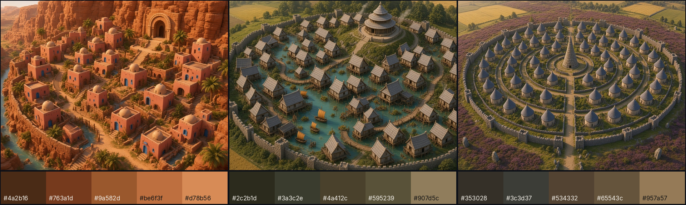

Three 300 m panels, left to right: **Cliff-Terrace** (rose-ochre plaster, cobalt accents, against a sandstone
wall), **Lagoon-Weavers** (silver-grey shingle on timber piles, saffron cloth) and **Ring-Builders** (pale
limestone drums with blue-grey slate cones). It is the same Iron-age town size in each; palettes follow
`docs/concept/settlements/index.md`. Each has a 5-swatch palette with hex codes under it.

**src/culture-a.jpg (Cliff-Terrace)** (aspect 4:3, reference image: hero-buildings-300m.png)

```text
Concept art for a god game, stylized realism: clean readable shapes, simplified but believable materials, a controlled palette slightly richer than real life but never neon, distinct value bands, physically lit. A strategy view from about 300 metres looking down at 45 degrees at an Iron Age town of the same size and layout as the reference image, but built by the Cliff-Terrace people against a red sandstone canyon wall: cube houses of rose and ochre plaster with small domed roofs, each roof the terrace of the house above, deep cobalt-blue doors and shutters, switchback stairs, cisterns and water channels, palm-like trees on every level, a large arched shrine niche carved in the rock where the temple was, a green river below. Signature palette: rose-ochre with cobalt blue. Golden-hour low sun from the left with long soft shadows, crisp detail. No photo-scan grit, no outlines, not cartoonish. No text, no labels, no watermark, no UI.
```

**src/culture-b.jpg (Lagoon-Weavers)** (aspect 4:3, reference image: hero-buildings-300m.png)

```text
Concept art for a god game, stylized realism: clean readable shapes, simplified but believable materials, a controlled palette slightly richer than real life but never neon, distinct value bands, physically lit. A strategy view from about 300 metres looking down at 45 degrees at an Iron Age town of the same size and layout as the reference image, but built by the Lagoon-Weaver people on timber piles in a shallow turquoise lagoon: long houses with tall saddle-shaped silver-grey weathered shingle roofs sweeping up to points, curved boardwalks around round water courts instead of lanes, floating vegetable rafts, a tiered round temple at the centre where the temple was, a woven breakwater, boats with ribbed saffron sails. Signature palette: silver-grey with saffron, over turquoise water. Golden-hour low sun from the left with long soft shadows, crisp detail. No photo-scan grit, no outlines, not cartoonish. No text, no labels, no watermark, no UI.
```

**src/culture-c.jpg (Ring-Builders)** (aspect 4:3, reference image: hero-buildings-300m.png)

```text
Concept art for a god game, stylized realism: clean readable shapes, simplified but believable materials, a controlled palette slightly richer than real life but never neon, distinct value bands, physically lit. A strategy view from about 300 metres looking down at 45 degrees at an Iron Age town of the same size as the reference image, but built by the Ring-Builder people on a highland plateau: concentric rings of round drum houses of pale limestone with tall conical blue-grey slate roofs, separated by dry-stone walls and garden rings, crossed by straight radial streets, a tall spire of stacked stone discs at the centre where the temple was, wedge-shaped fields radiating outward, standing stones along the approach, heather moorland. Signature palette: pale limestone with blue-grey slate and heather purple. Golden-hour low sun from the left with long soft shadows, crisp detail. No photo-scan grit, no outlines, not cartoonish. No text, no labels, no watermark, no UI.
```

| Panel | Swatches |
|---|---|
| cliff-terrace | `#4a2b16` `#763a1d` `#9a582d` `#be6f3f` `#d78b56` |
| lagoon-weavers | `#2c2b1d` `#3a3c2e` `#4a412c` `#595239` `#907d5c` |
| ring-builders | `#353028` `#3c3d37` `#534332` `#65543c` `#957a57` |

## do-and-dont.png

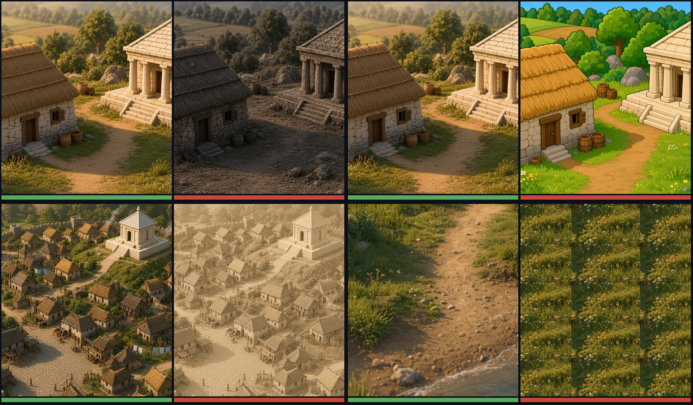

There are four pairs. In each pair the left image (green bar) is what we want and the right image (red bar) is the failure to avoid.

| Pair | Want (left) | Failure (right) | What to test |
|---|---|---|---|
| top left | `hero-buildings-40m.png` | photo-scan grit (`src/dont-grit.jpg`) | no high-frequency grime or stains on every surface; edges stay clean |
| top right | `hero-buildings-40m.png` | cartoon outlines and toy colours (`src/dont-toon.jpg`) | no dark outlines around shapes; no flat saturated toy colours |
| bottom left | `hero-buildings-300m.png` | beige-on-beige (`src/dont-beige.jpg`) | roof, wall and ground differ by at least 10 L* |
| bottom right | lower half of `hero-terrain-40m.png` | visible grid tiling (made in code, below) | no ground patch repeats inside the frame |

The tiling failure is not generated. `src/ext.py` cuts a 256 x 144 px patch of grass and path from
`hero-terrain-40m.png` and repeats it 5 x 5. The three generated failures used these prompts:

**src/dont-grit.jpg** (aspect 16:9, reference image: hero-buildings-40m.png)

```text
The same two buildings, camera and light as the reference image, but rendered as a gritty photogrammetry photo-scan: noisy high-frequency grime on every stone, dirty grey weathered thatch, desaturated muddy colours, gravel and debris everywhere on the ground, harsh crushed black shadows, cluttered busy surface detail with no clear shapes. No text, no labels, no watermark, no UI.
```

**src/dont-toon.jpg** (aspect 16:9, reference image: hero-buildings-40m.png)

```text
The same two buildings, camera and layout as the reference image, but rendered as a cheap cartoon toy: thick bold black outlines around every shape, flat plastic toy colours, candy-bright oversaturated yellow roof and neon green grass, rounded inflated shapes, no physical lighting, flat cel shading. No text, no labels, no watermark, no UI.
```

**src/dont-beige.jpg** (aspect 16:9, reference image: hero-buildings-300m.png)

```text
The same street block, camera and layout as the reference image, but everything in one flat beige-brown: roofs, walls, lanes and ground all the same dull tan colour and the same brightness, the roofs merge into the walls and the ground, washed-out flat lighting, low contrast, no distinct colours, hard to tell one building from another. No text, no labels, no watermark, no UI.
```

## Rejected takes (not delivered)

These are kept here so that every generated image has its prompt on record.

**Rejected towns-300m first take (beige-on-beige)** (aspect 16:9, reference image: art/style-pilot age-2-iron.png (earlier pilot image))

```text
Concept art for a god game played on one small living planet, stylized realism: clean readable shapes grouped into a few large deliberate forms, simplified but believable materials with clean joints and gentle edge highlights, a controlled palette slightly richer than real life but never neon, roofs, walls, ground and vegetation in distinct value bands, lifted clean shadows, physically lit. A strategy view from about 300 metres away, looking down at 45 degrees, at a whole Iron Age river town of about eighty houses built by the Valley people, in the same valley as the reference image: golden reed-thatch and dark brown wooden-shingle roofs on ochre mudbrick and whitewashed stone walls, a pale limestone temple with a light grey stone roof on a low rise as the lightest roof in frame, a round grey stone ring wall with square towers and a gatehouse, a clear network of packed-earth lanes leading to one cobbled market square, smoke from a few chimneys, laundry lines, a timber bridge over a blue-green river with a sandy bank and small boats, outside the wall a patchwork of ripe gold, green and freshly ploughed brown fields with hedges and worn footpaths, oak woods at the edges. Houses are about 40 pixels across. Golden-hour low sun from the left with long soft shadows, soft atmospheric haze toward the distance, crisp detail, every roof, wall, road and field reads as a distinct shape and colour. No photo-scan grit, no outlines, not cartoonish, not toy-like. No text, no labels, no watermark, no UI.
```

**Rejected buildings-2km first take (read as 300 m)** (aspect 16:9, reference image: hero-towns-300m.png)

```text
Concept art for a god game played on one small living planet, stylized realism: clean readable shapes, simplified but believable materials, a controlled palette slightly richer than real life but never neon, distinct value bands, lifted clean shadows, physically lit. A high oblique view from about 2 kilometres looking down at 50 degrees at the Iron Age town from the reference image, now seen small in the middle of the frame as a district: the round grey ring wall as a clear circle, inside it a dense field of warm golden-thatch and dark brown shingle roof colours, the pale limestone temple as a bright white mark on its rise, square wall towers and the gatehouse readable by silhouette and long shadow, a second smaller walled quarter and a forge with a column of smoke outside the gate, the timber bridge over the blue-green river, roads leaving the gates, a quilt of gold, green and brown fields around it, dark oak woods. Houses are about 8 pixels across. Golden-hour low sun from the left with long soft shadows, soft atmospheric haze toward the distance, crisp detail. No photo-scan grit, no outlines, not cartoonish. No text, no labels, no watermark, no UI.
```

**Rejected towns-2km first take (too close)** (aspect 16:9, reference image: hero-towns-300m.png)

```text
Concept art for a god game played on one small living planet, stylized realism: clean readable shapes, simplified but believable materials, a controlled palette slightly richer than real life but never neon, distinct value bands, lifted clean shadows, physically lit. A high oblique view from about 2 kilometres looking down at 50 degrees along the same green river valley as the reference image, with three settlements of different sizes and ages: in the middle the walled Iron Age town from the reference image as a round warm cluster of golden and brown roofs with its white temple mark; upstream a small Bronze Age village of a dozen straw-coloured roofs inside a timber palisade; downstream where the river meets a turquoise bay a growing harbour town with terracotta roofs and a few sailing ships. Each settlement reads as a coloured cluster with one landmark, pale dirt roads link them along the river, and each is ringed by its own quilt of gold, green and brown fields, larger around the bigger towns. Dark broadleaf woods on the slopes, grey rock ridges. Houses are about 8 pixels across. Golden-hour low sun from the left with long soft shadows, soft atmospheric haze toward the distance, crisp detail. No photo-scan grit, no outlines, not cartoonish. No text, no labels, no watermark, no UI.
```

## Known misses (all boards)

- **Camera distance at 40 m and 300 m is closer than specified.** House about 520 px at 40 m against a 300-500 px
  target, house about 60-75 px at 300 m against about 40 px, figures about 75-95 px at 1080p against 30-60 px
  (all measured by eye on the 1280 px heroes, scaled x 1.5 to 1080p).
- **The 2 km boards look down at about 35-40° with a horizon**, not 45-55°. buildings-2km and terrain-2km share
  almost the same composition because one is the reference for the other.
- **Flat value bands overlap in places.** Every hero reads in greyscale by shape, edge shadow and texture, but
  sampled pairs fall under ΔL* 10 on most boards (listed per board). Most often it is the sunlit lane against
  thatch, shaded thatch against foliage, or wall against shingle. The prompt asks for separate value bands, and
  the generator still compresses them in golden-hour light. In engine this is a grading and albedo target, not a
  pass.
- **The palettes lean warm brown.** Golden-hour light and straw and timber materials dominate the clusters. Greens
  and blues are under-represented in the 10-swatch strips (river and canopy colours appear in the sample tables).
- **Painterly or toy-like moments:** the harbour town and its oversized ships in towns-2km, and the Space-age
  panel.
- The heroes are 1280 x 720 (the generator's 16:9 size) shown 1:1 on the boards. They are not native 1080p.
- The 2 km boards have not yet been checked side by side with `shots/ue-cloudlab-terminator-final.png`. terrain-2km
  forest `#1c271a` sits close to the nature descent canopy-shade target `#1e2e1f`, and its fields are warmer
  than the descent targets.
- The style-pilot sheets named in "Read first" are missing from the repo (see above).
