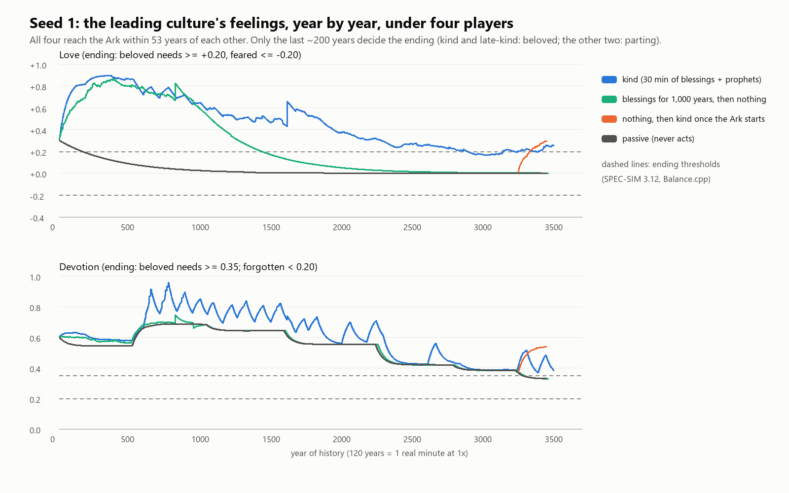

# DEMIURGE: player-experience design review (wave 2)

*Reviewer: Claude (lead's build agent, track "design-review"), 2026-11-19. No code was changed.*

**Sources.** `docs/CONCEPT.md`, `docs/SPEC-SIM.md` (all of it), `docs/SPEC-UI.md` sections 4, 4b and 5,
`docs/SPEC-UNREAL.md`, `Sim/Balance.cpp` (the integrator's live overrides), the 20 playthrough shots
`shots/ue-play-*.png`, the two sample chronicles in `docs/samples/`, and **198 headless histories** that I ran
for this review:

- `simrun --summary`, seeds 1-8, years 4,500, for each built-in policy (passive, kind, cruel, chaotic, doom):
  40 runs. Output: `claude-design-review/simrun-<policy>.txt`.
- A review driver (`claude-design-review/review-driver.cpp.txt`; it was built in a scratch folder and is not
  part of any build). It links every real Sim module plus the project's `Policies.cpp`, adds new scripted
  players and writes one CSV row per year: Awe, regard of everyone and of the leading culture, prayers,
  wars, and chronicle entries by weight. 102 runs on seeds 1-6. Results: `runs-matrix.txt` (60 runs) and
  `runs-experiments.txt` (42 runs).
- `simrun --set economy.expandCooldown=60` on seeds 1-6 (6 runs), which tests one of the proposals below.

**New players I scripted.** Each one plays the way a curious first-time player would:

| policy | what it does |
|---|---|
| `curious 900/1100` | The task's player. Lots of small blessings until year 900: answers prayers, heals, a dab of rain or bloom on a random town about every other year, now and then an Inspire. Then a burst of wrath until year 1100: it saves for the biggest wrath it can hold (meteor, volcano, quake, plague) and throws lightning while it waits. Then neglect to the end. |
| `curious 200/400`, `curious 2500/2700` | The same arc, with the wrath burst in the Stone age, or late in the Industry age. |
| `blessonly` | Small blessings until year 1000, then nothing. |
| `prayers` | Answers every prayer and does nothing else (a reactive "good enough" god). |
| `repent` | Wrath until year 800, then kind. |
| `sculptor` | About every 15 years, holds Raise or Lower Land for 1 s on a town (toys with the terrain). |
| `late-kind`, `late-cruel` | Does nothing until the Ark is being built, then plays the built-in kind or cruel policy. |

Time conversion used throughout: **1 real minute at 1x = 120 years** (SPEC-SIM 0.5).

*Seed 1, the leading culture's love and devotion under four players. The orange and grey lines lie on top of
each other until year 3,250. The ending is read off the last point of each line.*

---

## Verdict in one paragraph

The simulation is stable and deterministic, hits every SPEC-SIM section 4 target on 8 of 8 seeds, and a
history lasts about the length the concept promises (Ark at 3,440-4,020 years, 29-34 minutes at 1x). The
chronicle voice, the epithets and the ending screen are the best things in the game. **As a game, though,
it does not yet give the player authorship.**

- **The ending is decided only by the last ~200 years** (about 1.7 minutes). Doing nothing for 27 minutes
  and then being kind gives "beloved" on 6 of 6 seeds. Blessing the world for 1,000 years and then resting
  gives "parting" on 6 of 6.
- **The player cannot change the course of history.** Ark years under the kind, passive, cruel, chaotic and
  curious players differ by about 2%.
- **Four endings collapse into two.** "Forgotten" never happened in 198 runs, and almost every non-extreme
  player gets "parting".
- **Every power is unlocked about 5 minutes in** (in the Bronze age), so the later ages bring no new powers.
- **The first 9 minutes are nearly empty, and the last 15 minutes overflow with text.**

These problems are all fixable with rules and tuning. None of them needs a new system.

---

## Findings, ranked by impact

Each finding gives: **Problem / Evidence / Spec / Change / Headless test.** The tests can be built on
simrun's `--summary` targets plus the review driver's policies; I recommend folding those policies into
`Tools/simrun/Policies.cpp`.

### 1. CRITICAL: the ending reflects only the last ~200 years, not the player's history

**Problem.** Love fades by 0.25% a year toward 0 (`Balance.cpp`, `S.loveDrift`). The Ark is launched about
3,500 years in, so anything the player did before roughly the Industry age has faded to nothing by the
ending. What remains is decided in the 1-2 minutes before launch.

**Evidence.** All endings below are on seeds 1-6 (`runs-matrix.txt`, `runs-experiments.txt`):

| player | Awe spent before the Ark | ending | final love of the Ark culture |
|---|---|---|---|
| `blessonly` (1,000 years of blessings) | about 1,750 | **parting 6/6** | +0.00 on every seed |
| `curious 900/1100` | 1,500 good, 500 wrath | **parting 6/6** | +0.00 |
| `curious 2500/2700` (blesses for 21 minutes) | about 6,000 good | **parting 6/6** | -0.01 to +0.00 |
| `late-kind` (idle until year 3,250-3,490) | 0 | **beloved 6/6** | +0.23 to +0.52; devotion **0.54-0.58** |
| `late-cruel` | 0 | **feared 6/6** | -0.26 to -0.37 |
| `kind` (30 minutes of play) | about 1,800 strokes | beloved 6/6 | +0.23 to +0.31; devotion **0.38-0.51** |

The late-kind god, who did nothing for 27 minutes, ends with **higher devotion than the god who played kind
for the whole game**. It arrives at the Ark with a full 1,200-Awe bar and buys 6 prophets. The chart above
shows the shape: blessings are erased by year ~2,500, and the late player's line jumps from zero.

**Spec.** SPEC-SIM 3.12 (Endings, mood from `Society.regard` at launch); 3.8 Housekeeping (love drift);
`Balance.cpp` (`loveDrift 0.0025`, `prophetBonus 0.2`).

**Change.** Decide the ending from a **verdict**: the history the Ark culture remembers, not only how it
feels this year.

- Add per culture a long memory, `lore`, with a half-life of about 1,000 years:
  `lore += (good acts witnessed − harmful acts witnessed) × faith`. Daughter cultures inherit it from their
  parent at a schism.
- Ending mood = f(0.5 × current love + 0.5 × lore, devotion).
- Keep the current love drift for the day-to-day mood, so the HUD still reacts.
- Cap what can be bought late: a prophet raised in the last 150 years before launch adds devotion but no
  lore.
- One-line test of the direction: with `society.loveDrift=0.0005`, `blessonly` already moves from 0/6 to
  **3/6 beloved** (love stays at +0.23 to +0.26).

**Headless test** (new simrun targets, 6+ seeds):

- (a) `blessonly` and `passive` end in **different** moods on ≥ 5/6 seeds.
- (b) `late-kind` is **not** beloved on ≥ 4/6.
- (c) `late-cruel` is **not** feared on ≥ 4/6 (it ends "parting"/"two-handed").
- (d) `kind` stays beloved ≥ 6/8 and `cruel` stays feared ≥ 6/8.

### 2. CRITICAL: four endings collapse into two, and "forgotten" is unreachable

**Problem.** The concept promises four futures: the beloved god, the feared god, the forgotten god, and
silence. In practice almost every player gets "A Careful Goodbye" (parting), and the forgotten god never
occurs.

**Evidence.**

- Over every Ark ending of passive, chaotic, curious (all three timings), blessonly, prayers and sculptor
  (50 runs): **49 parting, 1 beloved**.
- **"Forgotten" occurred in 0 of 198 runs.** It needs devotion < 0.2, but the age baselines hold the Ark
  culture's devotion at 0.32-0.38 even when the god never acts.
- Even with the spec's original baselines (`--set society.baseline.5=0.18 baseline.6=0.10
  prophetBonus=0.15`), passive devotion is 0.24-0.26: still parting. With those baselines, kind falls to
  beloved on 2/6.
- The chronicle does notice neglect. In `curious 900/1100` seed 1 the peoples rename the god "the Silent
  One", "the Empty Chair" and "the Rumour". The ending ignores this.
- Answering every prayer (`prayers`: 4,600-6,400 Awe spent, love +0.14 to +0.46) ends in **parting on
  5/6**, because devotion is 0.24-0.37, below the 0.35 needed for beloved. Generosity without prophets gets
  the middling ending.

**Spec.** SPEC-SIM 3.12 mood thresholds; section 4 ("passive mostly forgotten or parting"); CONCEPT
"Endings".

**Change.** Define the moods by what happened:

- **forgotten**: the Ark culture's chronicle memory has heard no deed for ≥ 600 years (`heard`, the
  'Silent' epithet test already in `Chronicle.cpp`), *or* devotion < 0.30.
- **parting**: both hands remembered (the Mixed epithet), or love between −0.2 and +0.2 with recent deeds.
- **beloved**: verdict ≥ +0.2 and devotion ≥ 0.30, or answered prayers ≥ 60% of all prayers.
- **feared**: verdict ≤ −0.2.

**Headless test.**

- `passive` ends forgotten on ≥ 5/6.
- `chaotic` and `curious 900/1100` end parting on ≥ 4/6.
- `prayers` ends beloved on ≥ 4/6.
- `kind` ends beloved on ≥ 6/8, and `cruel` feared on ≥ 6/8.
- Across the 8 policies, each of the four Ark moods is the most common ending of at least one policy.

### 3. HIGH: the player cannot change the course of history

**Problem.** Blessings and wrath change how the people feel, but not how fast they progress. Ark years,
ages and late population hardly move whatever the player does.

**Evidence.**

- Ark year on seed 1 by player: passive 3,449; kind 3,502; cruel 3,496; chaotic 3,486; curious 3,446;
  prayers 3,505; blessonly 3,464.
- Over 8 seeds, each age arrives within about ±30 years under passive, kind, cruel and chaotic
  (`simrun-*.txt`).
- Kind raises population early (year 500: 2,440-3,367 against passive's 1,447-2,033) but not late (year
  3,000 on seed 1: kind 3.03M, passive 3.85M).
- Inspire, the power whose description is "Kindle new ideas", has no measurable effect. Kind uses it 3-11
  times per game, and ages arrive at the same years.
- Cruel throws 515-602 lightning bolts (plus 3-14 quakes) and reaches each age at the same years as passive.
  Its population at year 2,000 is 507-632k against passive's 512-677k.
- Only early, sustained wrath slows anything: `repent` (wrath until year 800) reaches Bronze 50-60 years
  later and launches the Ark 250-400 years later.

**Spec.** SPEC-SIM 3.7 (Growth, Research: `inspireF = 1 + 0.25 × share`, catch-up 1.5); 3.10 inspire and
bloom effects; CONCEPT pillar 2 ("every god power is a push on that web, and consequences ripple").

**Change.**

- **Inspire:** +2 progress-years per use for the culture, plus `inspireF` 1 + 1.0 × share (×4 now). Show it
  in the inspector ("learning 30% faster").
- **Blessed:** raises K by 15% for its 30 years, not only r.
- **Answered prayers:** each one adds 0.5 progress-years for that culture (priest-scholars).
- **Wrath that hits a capital or an academy:** sets that culture's research back 10-30 progress-years. A
  meteor then becomes a strategic choice (slow the aggressor), not only a mood.

**Headless test.**

- `kind`'s Ark is ≥ 150 years earlier than `passive` on ≥ 5/6 seeds.
- `cruel`'s is ≥ 150 years later on ≥ 5/6.
- A new `inspire-spam` policy (Inspire on the leading capital whenever affordable) reaches Space ≥ 200
  years before passive.
- The passive section 4 targets still pass.

### 4. HIGH: the first nine minutes are nearly empty

**Problem.** After awakening, the player watches one or two camps and one culture for about nine minutes at
1x, with almost nothing to respond to.

**Evidence** (per-year CSVs; 6 seeds; passive unless stated):

- The **Stone age lasts 505-549 years (4.4 minutes)** with on average **2.3 settlements, 1 culture,
  0.01 active prayers** and 3.1 minor plus 0.7 notable chronicle entries per real minute.
- **The second settlement appears in year 185 or 186 on every seed and every policy.** The first ~90 s
  after the awakening are a single camp: growth to 0.85 K takes a century even with a 60-year cooldown.
- The **second culture appears in years 721-1,072** (6-9 minutes).
- The **first war comes in year 756-3,038** (one seed had none at all).
- The **first prayer comes in year 349-767** (kind: 172-547).
- **Longest stretch with no notable (weight ≥ 2) chronicle entry: 298-535 years**, that is 2.5-4.5 real
  minutes, always in the Stone or Bronze age.
- Seed 1, the whole of years 27-184 in the chronicle: nothing. Then "A band from Ta Kripa crossed the
  country and founded Sonatombek".
- The playthrough shots show the same thing: `ue-play-09` (year 106, Stone age, 1 culture, 401 people) and
  `ue-play-10` (year 425, still Stone age, 1 culture).
- The cause is in `Balance.cpp`: `expandCooldown = 180` was chosen to hit the year-1,000 settlement count.
  It also starves the opening.

**Spec.** SPEC-SIM 3.7 (Expansion, research `ageNeed`); 3.10 natural-event protection ("not within 0.3 rad
… before year 100"); section 4 reference curve; CONCEPT "History (~30-40 minutes)".

**Change.**

- **Per-age settler cooldown:** 50 in Stone, 90 in Bronze, 180 from Iron.
  `--set economy.expandCooldown=60` already gives 5 settlements at year 300 (against 1-2) and 10-19 at
  year 500. Applied to every age, it also overshoots at year 1,000 (38-65 settlements against the 8-40
  target, 1/6 pass) and launches the Ark 150-180 years early. Hence the per-age rule.
- **Wake two bands** (30 + 20 people, two camps within 6 hops) so the map has a second dot at once.
- **Shorten the Stone age:** `ageNeed.0` from 375 to 250. Tested: Bronze 353-384 (in spec), Ark 80-150 years
  earlier, still in range.
- **One scripted "first trial" by year 40-60:** a dry year that starts a rain prayer near the capital,
  enabled by relaxing the 100-year natural-event protection for droughts only.
- **Make the second culture possible in the Bronze age** (`apartYears` 120 → 80 before Iron).

**Headless test.**

- Settlements ≥ 3 at year 200 and ≥ 6 at year 400, while settlements at 1,000 stay in 8-40 and at 3,000 in
  25-120.
- First prayer ≤ year 80 on ≥ 5/6 seeds.
- Second culture ≤ year 650 on ≥ 4/6.
- Longest stretch with no weight-2+ entry in years 0-1,000 ≤ 150 years (75 s).

### 5. HIGH: all 13 powers unlock in the Bronze age; ages unlock nothing after that

**Problem.** Each power wakes in its age *or* once the Awe cap can hold its threshold. The cap reaches every
threshold within a century of Bronze, so the age gates never matter.

**Evidence.**

- The 13th power unlocks in **years 585-665 (Bronze)** on every seed under passive, kind, cruel, prayers,
  blessonly and curious.
- `aweMax` passes 600 (the Volcano threshold) within about 100 years of Bronze: 695 at year 750 on seed 2;
  845 at year 709 in `ue-play-11`, where Meteor and Volcano are lit in the Bronze age.
- The Awe cap of 1,200 is reached by year ~1,250 (Iron) and stays there for the rest of the game.
- So the hint 'A new age. New powers wake with them.' (SPEC-UI 4, hint 6) is false from Iron onward: Iron,
  Sail, Industry, Atomic and Space bring the player nothing new.

**Spec.** SPEC-SIM 3.10 (unlock rule "age ≥ unlock.age **or** aweMax ≥ unlock.awe"); 3.8 aweMax formula;
SPEC-UI 4 (lock tooltip, hint 6).

**Change.**

- Drop the `or aweMax` path for wrath and grace powers after Bronze. Unlock by age only:
  Iron (plague, prophet, peace), Sail (meteor), Industry (volcano).
- Give Atomic and Space an **age upgrade** of an existing power: Rain becomes "Monsoon" (a wider brush);
  Meteor becomes "Star-fall" (a crater that makes a lake); Prophet becomes a "Council of prophets" (2 edicts).
- Raise `aweCap` per age (300, 450, 600, 800, 1,000, 1,200, 1,200), so the bar itself grows with the world.

**Headless test.** simrun prints an unlock table per run.

- On 6/6 passive seeds: meteor not before Sail, volcano not before Industry.
- Every age from Bronze to Space unlocks or upgrades at least one power.
- `aweMax` at year 1,000 ≤ 600.

### 6. HIGH: Awe is not a scarce resource; the full bar is its normal state

**Problem.** Unless the player spends constantly, Awe sits at its cap. A full bar wastes income and offers
no decision.

**Evidence.**

- Years at the Awe cap: **passive 84-86%; curious 57-59%; blessonly 60-62%; prayers-only 23-32%; kind 0%**
  (but kind's spending does not move history: finding 3).
- In the shots the bar is full early (`ue-play-09`: 124/125 at year 106) and nearly empty late (59-79 of
  1.2k in `ue-play-12` to `ue-play-15`, where the kind playthrough spends every point on Rain).
- A Rain brush costs about as much as late income (Rain 5/s at its default radius, income about 5.6 Awe per
  real second at 1x), so the obvious optimum is "keep the brush down".
- Section 4's "active policy below 90% of aweMax in ≥ 60% of years" passes, but only because kind and cruel
  spend reflexively. It says nothing about whether spending is a *choice*.

**Spec.** SPEC-SIM 3.8 (Awe), section 4 (Awe pacing); `Balance.cpp` (income 1.25 + 0.31 ln(1 + S)).

**Change.**

- **Hoarding has a cost.** While Awe ≥ 95% of the cap, devotion drifts down 1% a year: "the god who keeps
  everything does nothing".
- **Durable things Awe can buy:**
  - Consecrate (turn a shrine into a temple: +aweMax, +devotion). 150 Awe.
  - Raise a Wonder directly in a capital (the build edict needs a prophet first). 400 Awe, once per age.
- **Rain and Bloom cost ×2 when they cover no settlement's territory**, so painting the world is not free.

**Headless test.**

- `passive` sits at the cap ≤ 50% of years.
- `prayers` ≤ 15%.
- A `hoarder` policy (spends only on prayers, never on durable things) ends with lower devotion than
  `builder` (consecrates whenever affordable) on ≥ 5/6.

### 7. MEDIUM-HIGH: the god is named the Drowner for a sea the people raised

**Problem.** Towns drowned by the sea's late rise, which the people's own factories cause, are counted as the
god's deeds. The god is then named for them.

**Evidence.**

- Final epithet on passive seeds 1-6: **"the Sea's Elbow" ×4, "the Drowner", "the Deep"**. Same in every
  `curious` and `blessonly` run, by a god that never touched Lower Land.
- The kind playthrough's ending screen (`ue-play-17`) lists "Thitholi: the Drowner".
- The driver is the CO₂ sea rise of +0.25 to +0.39 (`simrun-*.txt`), which drowns 21-44 settlements.
- `Chronicle.cpp` credits "drown" to the god's memory (`chronicle_d`, `drownWeight 0.3`).
- In the sculptor run the opposite error happens: the god lowered the land, and the chronicle wrote "The
  sea rose at Ter Yusomia by a hand's width a year…".

A first-time player will feel both are unfair, because nothing on screen links the factories to the rising
sea.

**Spec.** SPEC-SIM 3.11 (epithets from what the god has actually done); 3.3 (sea rise); 3.7 (Hazards: sea
rose → drowned).

**Change.**

- Drownings caused by `Climate` sea rise do not count toward the god's Drowner score. They feed a chronicle
  thread instead: "The smoke of Losese's engines warmed the air, and the sea came up to meet it."
- Name the cause in the `sea-rise` climate milestone, and show a "the sea is rising: your people's engines"
  toast.
- Drownings from Lower Land, tsunami or quake keep the Drowner score, using the lowered-land template.

**Headless test.**

- On passive 6/6, the final epithet is never in the Drowner group.
- `doom` (Lower Land) still earns it on ≥ 5/6.
- A chronicle grep finds no "sea rose" text on a settlement destroyed within 2 years of a `lower` stroke
  within 0.1 rad.

### 8. MEDIUM: from the Sail age on, the chronicle is a firehose

**Problem.** Late in the game the chronicle produces far more text than anyone can read, and much of it
repeats.

**Evidence** (chronicle entries per real minute at 1x, 6-seed means):

| age | passive, minor | passive, notable | kind, minor | kind, notable |
|---|---|---|---|---|
| Sail | 54 | 17.5 | 62 | 36 |
| Industry | 65 | 29 | 69 | 56 |
| Atomic | 55 | 21 | 57 | 46 |

- At 4x that is up to 220 notable entries a minute. The feed shows 5.
- Kind writes 2,184 entries per run, including 343 "prayer answered", 220 famine and 178 rain-miracle
  entries.
- The most-used templates in `chronicle-kind-god.txt` repeat 31-36 times each, for example "The priests of
  X were still singing for rain when it began to fall on them" ×36.
- In `ue-play-12` to `ue-play-15` the toasts stack: "Sherefitheth's prayer is answered ×8", "Onshurona's
  prayer is answered ×7".
- Meanwhile the Stone age gives 0.7 notable entries a minute (finding 4). The text is spread unevenly.

**Spec.** SPEC-SIM 3.11 ("rate-limit minor entries"); SPEC-UI 4 (toasts), 4b (chronicle feed).

**Change.**

- A **notable budget**: at most about 6 weight-2 and 1 weight-3 entries per real minute at the current speed.
- Overflow folds into a **digest** ("That decade Thovi answered the prayers of seven towns of the Vai").
- A routine answered prayer drops to weight 1 after the first per culture per age.
- No template more than 10 times per history (least-recently-used choice per event type).
- In the HUD, one combined toast per kind per 10 s ("7 prayers answered").

**Headless test.** simrun reports per-age entries per real minute.

- Weight 2 ≤ 8/min and weight 3 ≤ 1/min in every age.
- No template used more than 12 times per run (hash the template id).
- Weight 2 ≥ 2/min in the Stone age, together with finding 4.

### 9. MEDIUM: famine is the main need, and an answered prayer does not end it

**Problem.** Famine drives most prayers, but answering the prayer does not end the hunger, and a kind god's
people starve more often than a neglected people.

**Evidence.**

- Famine is the second or third most common chronicle type: 156 entries per passive run, **220 per kind
  run (+41%)**.
- Most rain prayers come from famine (SPEC-SIM 3.8: rain prayer when famine ≥ 1).
- Rain raises moisture, but K for a settlement already over capacity hardly moves. Kindness also raises
  growth r (blessed, love), so the kind god's towns overshoot more.
- In the sample: "[430] Nara had prayed for rain, and the rain came in the night, and no one slept for
  joy." then "[432] Famine came to Nara." (`chronicle-kind-god.txt`).
- The player learns that answering does not help.

**Spec.** SPEC-SIM 3.7 (Growth, K), 3.8 (Prayers), 3.10 (rain, bloom effects).

**Change.**

- An **answered** rain or bloom prayer sets `blessed = 20` and raises K by 20% for that settlement for those
  years.
- A famine prayer becomes its own kind, "bread", answered by Bloom *or* Rain.
- The inspector says why the town is hungry ("more mouths than the land can feed: 412 / 360").

**Headless test.**

- Instrument `prayer:answered` for rain or bloom: famine = 0 within 5 years in ≥ 80% of cases.
- `kind` has ≤ passive's famine entries on ≥ 5/6 seeds.

### 10. MEDIUM: Raise and Lower Land drown a whole people in one second

**Problem.** In the history phase, one second of Lower Land under a coastal camp is enough to drown it, and
with it the whole people.

**Evidence.**

- `sculptor` (1 s of Raise or Lower on a random town about every 15 years) on seed 1: **three peoples
  drowned in 332 years** (Ta Kripa in year 70, Dun Pedek in year 192, Ter Yusomia in year 332), with two
  free re-awakenings in between.
- People were lost on seeds 1 and 5. Bronze came in year 853 instead of 517.
- `doom` ends 8/8 worlds in *silence* in years 364-503 with 2-11 Lower strokes. That is a complete,
  "earned" game ending after 3-4 minutes.
- Lower costs ×4 on owned land, but at 6/s it is still cheaper than one Heal.
- The armed chip does not warn that the stroke will drown anyone.

**Spec.** SPEC-SIM 3.10 (raise / lower: "A settlement whose centre goes under the sea is destroyed"); 3.12
(silence needs peakPop ≥ 1,000); SPEC-UI 4 (hover tip "why the target is invalid").

**Change.**

- In history, a single press of Lower may not take a settlement centre below sea level + 0.05. Drowning a
  town needs a second, deliberate press after the stroke ends.
- The hover tip shows a red line "This will drown Ta Kripa (412 people)".
- Silence also needs year ≥ 1,000, or ≥ 2 cultures ever, so a 4-minute world cannot "end".

**Headless test.**

- `sculptor` has people:lost = 0 on 6/6.
- `doom` still reaches silence on 8/8, now after year 1,000.

### 11. MEDIUM: wars are rare and late; diplomacy barely touches the player

**Problem.** War and peace are a small part of a history, and the peace powers are seldom needed.

**Evidence.**

- Share of years with any war: **passive 3.5%, kind 2.6%, prayers 2.5%, cruel 8.0%**. That is about 1 real
  minute of war in a 30-minute history.
- The first war comes in years 756-3,038.
- Kind used Omen of Peace 1-17 times per game.
- The war shot `ue-play-12` is the best-looking moment of the playthrough, and the game rarely produces it.

**Spec.** SPEC-SIM 3.8 (Relations, War); `Balance.cpp` (tradeK 0.015, relTarget −0.05, noise 0.05). The
integrator already raised the war rate from almost zero.

**Change.**

- Scale border friction by age (×1 Bronze to ×2 Atomic).
- Add a **war cause the player can see and act on**: a culture at war prays for victory (a 'victory'
  prayer, answered by a wrath power on the enemy), and the Crusade edict targets the least devout neighbour.
- Make wars name a goal (the enemy capital, or the Ark site in Space).

**Headless test.**

- Passive: war in 8-15% of years.
- First war ≤ year 1,300 on ≥ 5/6.
- Nuclear exchanges stay ≤ 1 per passive run.

### 12. MEDIUM: what a first-time player will not understand

Each line: the issue, the evidence, then the change.

- **"Beloved" from the first second.** Awakening sets love 0.3 and devotion 0.6, so the HUD says
  **Beloved** for the first 163 years (82 s) with no action, on 6/6 passive seeds (`ue-play-08`, year 1).
  The player thinks they have already won. *Change:* start love at 0.1, and give the HUD a neutral word
  ("Watched") until the god has done something.
- **The HUD word and the ending can disagree.** The HUD shows `regard(-1)` (everyone) while the ending uses
  the Ark culture. They disagree in >10% of years in 13 of 102 runs. *Change:* show the leading culture's
  verdict (finding 1) with its culture dot.
- **Two hidden axes and one word.** Love and devotion, the 0.35 / 0.2 thresholds and `jaded` are never
  shown. "Regarded" (SPEC-UI 4) explains nothing. *Change:* a two-axis "How they will remember you" marker
  from year 0, with the ending names in its corners. The current "They will leave you {mood}" Ark bar
  appears only at `ark:started` (~minute 27): too late to plan for.
- **Edicts look available but are not.** The inspector lists the four edicts from year 1 (`ue-play-08`),
  but they need a prophet, which needs Iron or Awe 300. *Change:* show the edicts dimmed with "Raise a
  Prophet to speak through them (wakes with the Iron age)".
- **The first hints arrive together, and the first one never leaves.** A shrine is built in year 1, so the
  shrine hint arrives with "Your people are awake…" and "Arm Rain…". Hints never time out: the shrine hint
  stays on screen from year 1 to year 2,356 in `ue-play-08` to `ue-play-14` and holds back the hint queue.
  *Change (client owner):* auto-dismiss after 12 s, and order the hints by teaching sequence.
- **Why the sea rose, and why they call the god the Drowner** (finding 7).
- **Why an answered prayer did not end the famine** (finding 9).
- **A broken pause shot.** `ue-play-11` ("pause", year 709, 8x) shows a black void with clouds and no pause
  screen. The camera appears to be inside the cloud layer. *Change:* for the client integration owner,
  check the 8x camera and the pause capture.

**Headless test.**

- simrun asserts `regard(lead).mood == regard(-1).mood` in ≥ 95% of years, or the HUD reads the lead.
- Passive is not "beloved" before year 20.
- The client scenario `-scenario=first-minutes` with no input shows ≥ 4 distinct hints in the first 600
  years, each visible ≤ 15 s.

### 13. LOW: pacing is front-light and back-heavy, and the default speed hides it

**Problem.** The history fits its length, but the interesting part arrives late, and the speed a player is
likely to pick hides that.

**Evidence.**

- At 1x the history runs 28.7-33.5 minutes (good).
- But the first 9 minutes hold about 0.7-1.3 notable entries per minute, and the last 15 hold 20-55.
- A player who uses 4x early (likely) reaches the Iron age in ~2 minutes, then must slow down.
- `ue-play-11` was captured at 8x in the Bronze age, and the camera broke there.

**Spec.** CONCEPT "History (~30-40 minutes at 1x)"; SPEC-UI 4 (time controls, "slow down for great
events").

**Change.**

- After fixes 4 and 8, add an **auto-pace option**: 2x while the notable rate is under 2/min, back to 1x on
  any weight-3 event or new prayer.
- Default it on for first games.

**Headless test.** simrun `--autopace` reports real minutes. The total is 25-35 minutes, and no real minute
has 0 notable entries.

---

## Answers to the brief

- **Is a 30-40 minute history fun to watch and influence?** Fun to *watch* from the Iron age on: wars,
  ships, city lights, a rich chronicle. It is thin before that, for about 9 minutes. It is barely
  *influenceable*: the player moves feelings, not history, and the feelings that count are only those of
  the last ~2 minutes (findings 1, 3, 4).
- **Where is the player bored, confused or powerless?**
  - Bored: the Stone and early Bronze ages (finding 4), and at a full Awe bar (finding 6).
  - Confused: by "Beloved" for free, the Drowner name, famine after an answered prayer, and edicts without a
    prophet (findings 7, 9, 12).
  - Powerless: over progress (finding 3) and over their own ending (finding 1).
- **Are the powers and the Awe economy interesting choices?** Not yet. Everything is unlocked by about
  minute 5 (finding 5). Idle Awe is the default (finding 6). The good powers are all variations of "raise
  love", and wrath has no strategic payoff (finding 3). The grace/wrath split and prayers are the right
  bones.
- **Do endings feel earned?** No. They are bought in the last 200 years (finding 1), and most players get
  the same "parting" (finding 2). The ending screen itself does feel earned, because the tale is written
  from the actual history.
- **What will a first-time player not understand?** Finding 12, plus the cause-and-effect links in findings
  7 and 9.

## The ten changes I would make first

1. **An ending verdict made from lore**: long memory plus current love; cap what can be bought in the last
   150 years (finding 1).
2. **Ending moods defined by what happened**: forgotten = neglect; parting = mixed; beloved reachable by
   answering prayers (finding 2).
3. **Grace and wrath move progress**: Inspire ×4, answered prayers add science, wrath on capitals or
   academies sets science back (finding 3).
4. **A per-age settler cooldown, two starting bands and a Stone age of 250**, with an early first prayer
   (finding 4).
5. **Age-only unlocks after Bronze, an upgrade per late age and an Awe cap per age** (finding 5).
6. **A cost to hoarding Awe and durable things to buy** (Consecrate, Raise a Wonder) (finding 6).
7. **The people's engines own the rising sea**: no Drowner name for it; a chronicle thread and a toast
   (finding 7).
8. **A notable budget, digests and template rotation; HUD toast merging** (finding 8).
9. **Answered rain or bloom prayers end famines** (blessed with +20% K) (finding 9).
10. **Lower Land cannot drown a town in one press; a drowning warning; silence needs year ≥ 1,000**
    (finding 10).

Each has its headless test above. Together they need about 8 new simrun targets and 6 new scripted
policies (`curious`, `blessonly`, `prayers`, `repent`, `sculptor`, `late-kind` / `late-cruel`), all of
which already exist in the review driver.

## The five things that already work best

1. **The chronicle's voice and the epithets.** Three examples: "Tre'rat was founded in the 369th year. Its
   founders swore it would one day be greater than Sonatombek. The chronicle notes that all founders swear
   this."; "Lightning came down … the farmers said it was a waste of a good tree."; the neglect names
   ("the Empty Chair", "the Rumour"). It is the game's personality, and it reacts to what happened (up to 38
   epithet entries per run).
2. **The ending screen and time-lapse** (`ue-play-17`, `ue-play-18`, `ue-play-19`). "Carried to the Stars",
   each people's own name for the god, a tale with real numbers ("288 were answered and 13 went unheard"),
   and a 150-frame replay with weight-3 captions. When the verdict is fixed, this screen will make the
   ending land.
3. **A stable, deterministic, well-paced simulation.** It passes all section 4 targets on 8/8 seeds: ages
   in range, Ark at 3,439-3,820, peak anomaly +3.5 to +4.1 °C, sea rise +0.25 to +0.39, mean tick
   1.3-2.2 ms, and no NaN in 198 runs. It is ready for design tuning, which is rarely true at this
   stage.
4. **The prayer loop as the core verb.** From Iron on, 0.5-2.5 prayers are active at a time. The Now strip
   shows them ("2 pray for peace", "1 prays for rain"). Answering doubles faith and gives love +1, and
   the chronicle answers back. This is the right "god game" verb and the obvious place to hang findings 1,
   3 and 9.
5. **Orbit readability and the inspector's plain language.** `ue-play-14` and `ue-play-15` show labelled
   cities, roads and night lights that read at a glance. The inspector says "395 people, growing. The land
   could feed 678." and has a five-word love scale (terrified … adoring). Those are exactly the explanations
   the rest of the HUD should copy (finding 12).

---

### Reproducing

- simrun: `powershell -NoProfile -ExecutionPolicy Bypass -File Unreal/Tools/simrun/simrun.ps1 --seeds 1-8
  --years 4500 --policy 
 --summary --jobs 8`
- The driver: copy `claude-design-review/review-driver.cpp.txt` to `review.cpp` and
  `review-driver-build.ps1.txt` to `build.ps1` in an empty scratch folder, then run `build.ps1`. It compiles
  every Sim module plus `Tools/simrun/Policies.cpp` read-only into `./build/review.exe`. Then run
  `review.exe --seed N --policy P [--bless Y --wrath Y] [--set k=v] --out <dir>`.
- In `runs-experiments.txt`, the RESULT lines do not name `--set` values:
  - `passive` rows with Bronze in years 353-384 are `economy.ageNeed.0=250`.
  - The other `passive` rows, and all `kind` and `prayers` rows, use the spec baselines
    (`society.baseline.5=0.18`, `society.baseline.6=0.10`, `society.prophetBonus=0.15`).
  - `blessonly` rows are `society.loveDrift=0.0005`.
- The chart is `claude-design-review/chart.py.txt`, run on the driver's CSVs.
